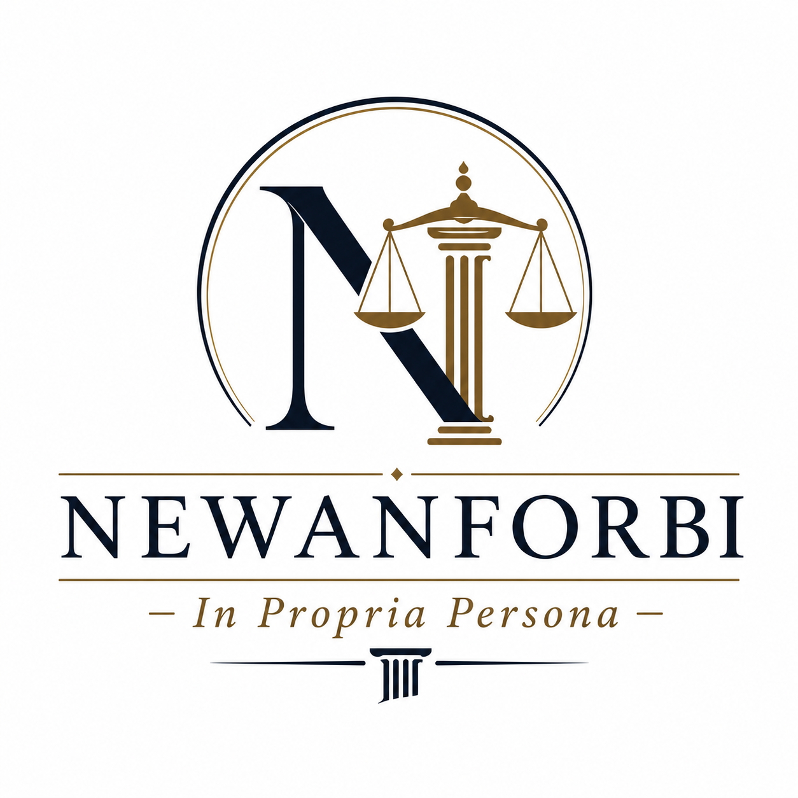

# Interactive Litigation Portfolio

An interactive, single-page litigation dashboard for **Brendan Ngehsi Newanforbi**, Pro Se / In Propria Persona. The portfolio tracks 31 civil matters across federal and California state courts, providing a structured view of case status, procedural history, damages exposure, and overarching legal theories. **Live site:** https://interactive-litigation-portfolio.vercel.app · 

<br clear="left" />

## Overview

| Field | Detail |
|---|---|
| Plaintiff | Brendan Ngehsi Newanforbi |
| Representation | Pro Se / In Propria Persona |
<!-- PORTFOLIO:OVERVIEW_COUNTS:START -->
| Total Matters | 31 |
| Active / Open | 14 |
| Settled | 1 (Matter 22 — Newanforbi v. Pilot Travel Centers LLC, July 14, 2026) |
| Dismissed / Closed / Abandoned | 16 |
<!-- PORTFOLIO:OVERVIEW_COUNTS:END -->
| Jurisdictions | USDC E.D. Cal., USDC N.D. Cal., San Joaquin Sup. Ct., Alameda Sup. Ct., Sacramento Sup. Ct., Santa Clara Sup. Ct. |
| Housing Status | **Homeless since July 2, 2026** — direct consequence of retaliatory inter-county parole transfer (Stockton → Santa Clara) imposed immediately after filing Matter 15 (Newanforbi v. CDCR, et al.); transfer caused loss of Stockton family housing; Matters 3, 9, and 19 are also potential retaliatory predicate acts |
| Representation | Pro Se / In Propria Persona — all 31 matters self-litigated; estimated equivalent private-counsel cost: $756,084–$1,251,376 |
<!-- PORTFOLIO:OVERVIEW_EXPOSURE:START -->
| Aggregate Exposure (Conservative) | ~$1,161,000+ |
| Aggregate Exposure (Moderate) | ~$2,957,000+ |
| Aggregate Exposure (Aggressive) | ~$6,579,000+ |
<!-- PORTFOLIO:OVERVIEW_EXPOSURE:END -->
| Last Updated | August 1, 2026 |

<!-- PORTFOLIO:CLOSED_COUNT_NOTE:START -->
*Of the 16 dismissed/closed/abandoned matters, 7 carry an ABANDONED / NOT PURSUING disposition (voluntarily withdrawn, including for safety-driven reasons). See [All Matters](#all-matters) below for the full disposition table. Matter 30 remains pending/pre-complaint in the Active table when its record is not archived.*
<!-- PORTFOLIO:CLOSED_COUNT_NOTE:END -->

---

## Case Clusters

### Cluster 1 — CHP Traffic Stop, DUI Arrest & DMV APS Challenge (Matters 1, 2, 7, 8, 20, 24)

Arising from a November 1, 2024 CHP encounter on I-580. Officers arrested Plaintiff after he declined an optional PAS test, despite dashcam footage contradicting the DUI report's fabricated observations. No charges were filed; a 5-day parole hold followed. The cluster spans six matters:

- **Matter 1** (USDC E.D. Cal.): Federal §1983 against CHP officers; adverse F&R issued April 20, 2026 (Magistrate CSK recommends MTD GRANTED WOLA — 4th/14th Amendment, qualified immunity); District Judge DC adoption pending. If adopted, Matter 2 (Alameda, stayed) becomes the primary vehicle.
- **Matter 2** (Alameda Sup. Ct.): Parallel state tort action (False Imprisonment, Battery, Bane Act); STAYED pending Matter 1 District Judge ruling.
- **Matter 7** (USDC E.D. Cal.): Federal §1983 against DMV Hearing Officer Candelaria and DMV Director Gordon; adverse F&R issued June 15, 2026 (Magistrate CSK: IFP denied as frivolous; FAC dismissed WOLA — quasi-judicial immunity for Candelaria, 11th Amendment / standing failure for Gordon); District Judge DC adoption pending.
- **Matter 8** (Sacramento Sup. Ct.): State Writ of Administrative Mandate challenging the same void APS decision; Fee Waiver Hearing held July 17, 2026, Dept. 10C.
- **Matter 20** (Alameda Sup. Ct.): State Writ of Mandate against CHP; demurrer opposition filed July 13, 2026; CHP demurrer hearing Aug. 28, 2026. Individual Respondents Serrato, Paul, and Dutra filed their own joinders/demurrers July 30, 2026 and stipulated to advance their Oct. 16/23 hearing dates to Aug. 28 as well (stipulation not yet entered).
- **Matter 24** (USDC N.D. Cal.): §1983 against San Mateo Sheriff Deputy Serrato for arbitrary U Visa certification denial and retaliation; filed June 17, 2026; CMC September 15, 2026.

### Cluster 2 — Parole Retaliation, HOPE Abuse & Policy 19-03 (Matters 3–6, 11, 13–18, 21, 28, 30)

The largest cluster — 14 matters — targeting CDCR's parole supervision apparatus, the HOPE Psychotherapy program, and constitutional violations across parole travel, housing, and employment decisions. Core allegations include:

- **First Amendment retaliation** by Agent Derrick, who suppressed speech and sabotaged Plaintiff's FedEx employment; explicit "you do not have freedom of speech" statement satisfies *Rhodes v. Robinson*.
- **Retaliatory inter-county transfer** on July 2, 2026 — supervision moved from San Joaquin to Santa Clara County immediately after filing Matter 15 naming Supervising Agent Noguchi; caused loss of Stockton family housing and employment; Plaintiff has been **homeless since July 2, 2026**. Matters 3, 9, and 19 are also potential retaliatory predicate acts for the transfer.
- **HOPE's structural fee incentive** (~$9,690–$10,600/year per parolee at standard billing rates; condemned in *In re Dwyer*, SC-080355A, San Mateo County Super. Ct., Mar. 20, 2023) with no completion credit — financial incentive to retain rather than discharge.
- **HOPE's blanket retention policy** requiring the full parole term regardless of clinical progress — documented in HOPE's own Clinical Operational Manual (HOPE_000294) and condemned in *In re Dwyer*; now forms the Monell theory in Matter 28.
- **Retaliatory reporting** — false no-shows logged and adverse CDCR Form 3043 reports directed by Shannon Smith; HOPE_000142/194 (produced in Matter 5) documents a no-show logged despite agent-confirmed technical error.
- **Facially defective Discharge Review** (November 2025) containing a copy-paste error naming "Eagan" rather than Plaintiff; fabricated 6.5-year retention minimum sourced from academic research rather than statute; unemployment (caused by Defendants' own conduct) cited as aggravating factor.
- **Policy 19-03** enforced after 15 CCR § 3574 superseded it in April 2025 — ultra vires categorical bar.
- Documented CDL career wage losses: $109,408 across 6 carriers (W-2 verified, 2022–2024).
- **Matter 5 (Palacios)** — state action disposed July 15, 2026 (demurrer sustained, exhaustion grounds); 542 pages of HOPE discovery (Bates HOPE_000001–542) produced before dismissal are now carried into **Matter 28** via Motion for Protective Order.
- **Matter 15** (San Joaquin Sup. Ct., STK-CV-UPI-2026-5417) — **ABANDONED.** Would have asserted Negligence, False Imprisonment, IIED, and Breach of Mandatory Duty against CDCR, Dodd, and Noguchi — the highest single-matter exposure in the portfolio. Complaint was filed and both individual defendants personally served; a responsive-pleading extension had been agreed with Deputy Attorney General Judith S. Gronna. Voluntarily dismissed with prejudice as to all defendants on July 24, 2026 due to a real, credible safety threat — unrelated to the Matter 19 habeas ruling.
- **Matter 28** (USDC N.D. Cal., Case No. 3:26-cv-07504, Hon. Lisa J. Cisneros): Federal successor; §1983 Monell (HOPE) + Individual Capacity (Shannon Smith, LCSW), Bane Act §52.1, Fraud/Negligent Misrepresentation, RICO 18 U.S.C. §1962(c)-(d); case filed July 20, 2026, Initial CMC set October 22, 2026.
- **Matter 30** (USDC N.D. Cal., San Jose Div.) — **PENDING (pre-complaint), filing contingent on parole discharge.** Asserts §1983 First Amendment Retaliation + Due Process, Bane Act §52.1, and IIED against Long Moua (Badge #7472), for the November 14, 2025 retaliatory 1502-DR and the July 2, 2026 inter-county parole transfer; Government Claims Act claim filed July 18, 2026, anticipated deemed-rejected September 1, 2026. This matter is not abandoned: Plaintiff intends to file it if discharged from CDCR parole supervision before its filing window closes, notwithstanding the safety-driven caution that led to abandoning the companion matters below. Outer deadline for the state-law claims is on or about March 1, 2027 (Gov. Code §945.6(a)(1), six months from the deemed rejection); the §1983 claims run on the longer two-year limitations period.
- **Matters 3, 4, 14, 16 (Derrick, Urrea, Rojo)** — all **ABANDONED** due to a real, credible safety threat. Matter 3's federal MTD was under submission at the time of withdrawal; Defendant Palacios's exposure survives independently through Matter 5's discovery record and Matter 28. Matters 6, 11, 13, 17, 18, and 21 — the federal §1983 companion suits against HOPE, Macomber, Urrea, Maloney, and Barocio, all filed the week of January 22, 2026 — were voluntarily dismissed (five with prejudice, together, on June 29, 2026) once the surviving vehicles above made the parallel federal claims unnecessary.

### Cluster 3 — Consumer Fraud / Defective Vehicle (Matter 12)

Fraud and UCL claims against Diamond Truck Sales, Inc. and Alpine Truck Sales, Inc. for concealing a DEF/emissions defect and prior CHP out-of-service order on a 2014 Volvo VNL (VIN: 4V4NC9EH6EN142206) purchased for $26,900. The truck entered catastrophic derate mode immediately after purchase, rendering it commercially unusable. Direct documented losses ~$25,129.44; lost hauling income >$46,800. Diamond Truck Sales, Inc. served March 11, 2026 — no response filed; default judgment request submitted June 15, 2026. Alpine Truck Sales, Inc. personally served July 1, 2026 (Mustagem Usmani, Manager, 1201 S Soderquist Road, Turlock); response deadline July 31, 2026; no meet-and-confer contact received. Request for Default Judgment pre-drafted. CMC: August 12, 2026, 8:30 AM, Dept. 11B, Hon. Robert T. Waters.

**Expected recovery — favorable August 12, 2026 CMC:** With both named defendants in default (Diamond since April 10, 2026; Alpine deadline July 31, 2026 — before CMC), the August 12 hearing is the prove-up entry point. A favorable ruling is expected to yield:

| Component | Amount |
|---|---|
| Documented Out-of-Pocket (deposit $12,345.10 + GAP $1,895 + DMV $3,442 + Brannon Tire $1,197.34 + Mobile Will's $740 + Golden Empire Towing $562.50 + Western Truck Center $36.71) | $20,218.65 |
| Undocumented Out-of-Pocket, sworn testimony (Commercial Towing $750 + Almaraz Diesel $5,000) | $5,750.00 |
| Lost Commercial Hauling Income (18 wks × $1,300/wk; Amazon Relay carrier agreement on file) | $23,400.00 |
| Prejudgment Interest (Civ. Code §3287(a); 7% × ~3.04 yrs on documented losses) | $4,302.55 |
| **Compensatory Subtotal (per Declaration ISO Default Judgment, filed June 15, 2026)** | **$53,671.20** |
| Punitive Damages (Civ. Code §3294; fraudulent concealment + intentional misrepresentation; Diamond→Alpine rebrand as consciousness-of-liability badge) | ≥ $25,000.00 |
| Costs of Suit (per Form MC-010 — filing fees, sheriff's service fees, etc.) | per MC-010 |
| **Total Monetary Judgment Requested (per Default Judgment Packet)** | **≥ $78,671.20 + costs** |

*The $78,671.20 floor is established in the Declaration ISO Default Judgment filed June 15, 2026 against Diamond Truck Sales, Inc. Punitive damages and costs are subject to judicial discretion at the August 12, 2026 prove-up hearing. Lost income was deliberately underpled at 18 weeks (conservative) versus the FAC's $46,800+ allegation; FAC paragraph 31 controls the Greenup v. Rodman notice ceiling on lost income.*

**Post-judgment collection prep (as of July 29, 2026 — no judgment entered yet):** EJ-001 (Abstract of Judgment), EJ-130 (Writ of Execution), AT-138/EJ-125 (Judgment Debtor Examination), and MC-012 (Memorandum of Costs After Judgment) are pre-drafted with the case's fixed facts (parties, court, case number) already filled in, so they're ready to complete and file the same day or next business day once the Aug. 12 CMC actually produces a judgment — no field asserts a judgment date or amount that hasn't happened. Alpine's joint-and-several exposure runs through its own pre-drafted default judgment packet (CIV-100, execution date Aug. 1, 2026), not a CCP §187 motion to amend the judgment — §187 amendment adds an alter ego who was never a named party, and generally isn't available where the underlying judgment is by default; Alpine is already a named, personally-served defendant, so its own default judgment is the correct vehicle.

**Default judgment packet review findings (flagged Jul. 29, 2026):**
- **Case number error** — every CIV-100 in both the Diamond and Alpine default judgment packets, and the original [Proposed] Judgment (JUD-100), showed the case number as `STK-CV-UF-2026-1094` instead of the actual `STK-CV-UF-2026-0001094`. The JUD-100 has been corrected (new file in the documents list, ready to submit at the Aug. 12 CMC) and also now names Alpine — not just Diamond — in Item 5a's operative "against defendant" field, since the original only mentioned Alpine's joint-and-several liability in freeform Item 8 text, which the abstract-of-judgment and writ-of-execution forms aren't built to read. Diamond's CIV-100/Declaration were already submitted to the court on 6/15/26 with the case-number error baked in — that can't be fixed by editing a repository copy; confirm with the clerk that the case docketed correctly, and fix Alpine's CIV-100 before it's filed Aug. 1.
- **"Osmani" vs. "Usmani"** — Alpine's own Declaration ISO Default Judgment (¶6) cites "the same Osmani family ownership and management" as part of the sworn evidentiary basis for the alter-ego/successor theory, but the only individual named anywhere else in the service record is Usmani (spelled two ways: "Mustagem" and "Mustaqem"). Confirm which name is correct before it's relied on further — this is now inside a sworn filing, not just outside planning notes.
- **Standing question on the lost-income claim** — the Lease-On Owner Operator Agreement behind the $23,400 lost-income figure is contractually between Gobbato Builders, LLC and a separate registered entity, "Altamont Freight LLC" (confirmed by its own W-9 and Amazon Relay driver roster, at a different Modesto address), not personally Brendan Ngwa Nforbi, though the Declaration frames the loss as his personally. Unlikely to be caught in an uncontested default prove-up, but worth resolving before relying on it in a contested posture.
- **DMV fee vs. pending use-tax exemption** — the $3,442 DMV fee claimed in full as damages includes ~$2,421 in CA use/city-use tax that a CDTFA exemption request in the same exhibit set sought to avoid; the Declaration doesn't disclose whether that exemption was granted, which could reduce the true out-of-pocket DMV obligation if it was.

**Bank levy prep (added Jul. 29, 2026; central-location question resolved Jul. 29, 2026):** AT-167/EJ-152 Memorandum of Garnishee — the form a garnishee bank returns to the levying officer disclosing what it holds, not a notice-of-levy instrument the creditor serves — has been caption-prefilled for both known target institutions (Bank of Stockton and JPMorgan Chase) against both Diamond and Alpine, four draft copies total, items 3–9 left blank for the bank to complete. Garnishee addresses used are each bank's Turlock branch nearest 1201 S Soderquist Road (Bank of Stockton, 134 S Golden State Blvd; Chase, 2951 Countryside Dr).

Both banks almost certainly exceed the 9-branch threshold under CCP §684.115, which requires financial institutions with more than nine California branches to designate a single central location for levy service statewide, filed with DFPI. DFPI's actual *Central Locations for Service of Legal Process* registry was obtained and searched in full (every cell, not just institution-name matches): **neither JPMorgan Chase Bank, N.A. nor Bank of Stockton has ever filed a designation.** The registry isn't limited to DFPI-licensed institutions — it includes other OCC-chartered national banks (e.g., American Plus Bank, N.A.; Chino Commercial Bank, N.A.), so the absence isn't a charter-type artifact. Under §684.115's default rule, a financial institution that fails to designate has *every* California branch deemed a valid central location for service. Net effect: the two Turlock branches above are legally valid levy targets for both banks as-is; no further address confirmation is needed. (Registry caveat: DFPI's file was last updated with new filings through Sep. 22, 2025, so a designation filed after that date wouldn't appear — low residual risk here since neither bank has any filing history at all, not a recently-lapsed one. Bank of Stockton's separate DFPI *regulated-entity* listing, a different dataset entirely, confirms its license and HQ at 301 East Miner Avenue, Stockton — supporting context, not a substitute for the central-locations finding.)

None of this is actionable yet regardless: it depends on the Writ of Execution (EJ-130) actually issuing, which requires a judgment first.

### Cluster 4 — Administrative Writs & Habeas Corpus (Matters 9, 10, 19)

Three equitable proceedings seeking court orders directing CDCR to act — no tort damages sought. Two are now closed; one remains active:

- **Matter 9** (Sacramento Sup. Ct., 26WM000028): Writ of Mandate — **CLOSED**. Demurrer sustained without leave to amend May 29, 2026 (Hon. James P. Arguelles, Dept. 13A): CDCR has no duty under Pen. Code §3008 to conduct an individualized EDC assessment where §3000(b)(2)(B) mandates a 10-year parole term; habeas corpus is the correct vehicle. The substantive claim is live in Matter 19.
- **Matter 10** (Santa Clara Sup. Ct., C2602632): Habeas Corpus — **CLOSED**. Petition denied without prejudice April 27, 2026 (exhaustion; PC §3008(d)(2) certification required).
- **Matter 19** (Santa Clara Sup. Ct., C2604791): Habeas Corpus — **ACTIVE**. Seeks immediate and unconditional discharge from parole; filed April 3, 2026; Order Extending Time issued July 2, 2026 (Hon. Robert Hawk); court deadline to rule: **August 1, 2026**.

### Cluster 5 — Employment / Statutory Violation (Matters 22, 25, 26, 27, 29, 31)

Five matters asserting Penal Code § 290.46(j)(2)(E) — the categorical prohibition on using sex offender registry information for employment purposes — against separate employers across a 30-month window, plus a sixth matter (31) asserting vendor-side FCRA/ICRAA liability against the background-check company that supplied two of those registry-flagged reports.

- **Matter 22** (Newanforbi v. Pilot Travel Centers LLC) — **SETTLED July 11, 2026** — San Joaquin Superior Court (STK-CV-UWT-2026-0007649). Wrongful termination; Defendant's own Post-Adverse Action Notice admitted registry as sole termination basis. Resolved pro se in under seven weeks from filing, before service was completed. First portfolio settlement.
- **Matter 25** (Newanforbi v. Federal Express Corporation) — San Joaquin Superior Court (STK-CV-UWT-2026-0009118); PC §290.46(j) failure to hire; First Advantage BGC ran March 2025; final adverse action March 19, 2025; complaint filed July 15, 2026; assigned to Dept. 10B, Hon. Blanca Banuelos; CMC January 14, 2027. LA County Sheriff's Department confirmed acceptance of the SER-001 service request July 21, 2026 (File No. 2026075280, fee waiver applied). **SERVED July 24, 2026** on Ct Corporation System (Jaqueline Mejia, CA Authorized Employee), per the Sheriff's Civil File Status.
- **Matter 26** (Newanforbi v. United Parcel Service, Inc.) — San Joaquin Superior Court (STK-CV-UWT-2026-0009113); PC §290.46(j) failure to hire; First Advantage BGC ran July 2024; final adverse action July 31, 2024; complaint filed July 15, 2026 — **2-year limitations period preserved (filed 16 days ahead of the July 31, 2026 cutoff)**; UPS filed first (lower case number); assigned to Dept. 11B, Hon. Robert T. Waters; CMC January 13, 2027. **SERVED July 22, 2026** on Josh Swindell, Authorized Agent, per the Sacramento County Sheriff's Civil File Status (the sheriff's civil file itself shows Closed as of July 23, 2026, reflecting only completion of the service assignment — the underlying action remains active).
- **Matter 27** (Newanforbi v. Randstad US, LLC and RK Logistics Group, Inc.) — Alameda Superior Court, Case No. **26CV199902**, Hon. Karin Schwartz, Dept. 20; PC §290.46(j) / FCRA / ICRAA / Tameny wrongful termination. Rehired July 7, 2026; InfoMart BGC (Order No. 15780719) shows Billing Code "RK LOGISTICS" and Status "NEEDS APPROVAL, PER CLIENT CRITERIA" with registry as the sole adverse flag; Randstad terminated employment July 15, 2026, two business days after the FCRA pre-adverse notice — short of the 5-business-day waiting period. Verified Complaint e-filed July 20, 2026 via One Legal; Complaint, Civil Case Cover Sheet, and Fee Waiver accepted; corrected Summons ELECTRONICALLY FILED/ACCEPTED July 21, 2026. Pre-filing demand letters ($85,000 each) sent to both defendants the same day. **On July 21, 2026, RK Logistics denied the demand through counsel Garcia & Gurney, ALC (Melinda Garcia, Esq.)**, arguing (1) Randstad, not RK Logistics, was the employer, and (2) the rejection was MVR-based, not registry-based. Neither ground reaches Randstad, which has not responded; the employer-status argument is also undercut by RK Logistics' own Transportation Manager's written rejection email, and the MVR defense cites a commercial (Class A) disqualification inapplicable to the non-commercial Class C position at issue. **SERVED July 30, 2026, 1:34 PM** on both defendants (Josh Swindell, Authorized Agent) per the Sacramento County Sheriff's Civil File Status (File No. 2026026857; sheriff civil file Closed as of July 31, 2026 reflecting only completion of the service assignment — the underlying action remains active); responsive pleading due August 31, 2026.
- **Matter 29** (Newanforbi v. Amazon.com Services, LLC and Accurate Background LLC) — anticipated Alameda Superior Court; PC §290.46(j) / FCRA / ICRAA / IIED failure to hire. Application submitted; pre-hire appointment attended July 7, 2026 (Fremont, CA); Accurate Background LLC (shortcode 45996) BGC submitted July 7, 2026; BGC pending 10+ days as of July 17, 2026; adverse action anticipated. Sixth PC §290.46(j) matter in portfolio; complaint not yet filed. **Critical precedent: Lerma v. Amazon.com Services, LLC et al., No. 8:22-cv-01727 (C.D. Cal., settled Sept. 29, 2023)** — putative class action against the same two defendants (Amazon + Accurate Background) on the same PC §290.46(j) registry theory; Amazon's post-settlement continuation of the identical practice in 2026 establishes willfulness under Civ. Code §3294.
- **Matter 31** (Newanforbi v. First Advantage LLC) — anticipated San Joaquin Superior Court; FCRA §1681b(b) / FCRA §1681e(b) / ICRAA / Negligence Per Se / UCL §17200. **Identified July 30, 2026 via a portfolio-wide gap analysis**, not yet filed and no demand letter sent. First Advantage LLC is the background-check vendor that generated and transmitted the registry-flagged reports and every pre-adverse/adverse notice underlying both Matter 25 (FedEx, March 2025) and Matter 26 (UPS, July 2024) — the same role Accurate Background LLC plays in Matter 29 and HireRight played in the abandoned Matter 23 — yet First Advantage itself was never joined as a defendant in either matter. This vendor-liability theory is additive to, not duplicative of, Matters 25/26: it targets First Advantage's own furnishing conduct rather than the employers' use of the reports, and deliberately excludes the emotional-distress/lost-opportunity damages already claimed there to avoid double-counting.

---

## All Matters

### Active / Open

<!-- PORTFOLIO:ACTIVE_MATTERS:START -->
| # | Caption | Case No. | Court | Type | Status |
|---|---|---|---|---|---|
| 1 | Newanforbi v. CHP et al. | 2:25-cv-01460-DC-CSK | USDC E.D. Cal. | Federal | Filed 05/27/2025; Magistrate Judge issued Findings & Recommendations RECOMMENDING DISMISSAL (Apr. 20, 2026) |
| 2 | Newanforbi v. Meza-Gonzalez et al. | 26CV168913 | Alameda Sup. Ct. | State | STAYED — Stipulation for Stay filed Apr. 14, 2026; U-Visa Certification Motion briefed (Opp. June 5, 2026; Reply June 8, 2026) and heard June 18, 2026 at 2:30 p.m. (Dept. 518) |
| 7 | Newanforbi v. Candelaria | 2:26-cv-00983-DC-CSK | USDC E.D. Cal. | Federal | Active — FAC filed Apr. 27, 2026; Magistrate Judge Chi Soo Kim issued Findings & Recommendations (ECF No. 6, Jun. 15, 2026) recommending IFP denial and dismissal WITHOUT LEAVE TO… |
| 12 | Brendan Ngwa Nforbi v. Diamond Truck Sales, Inc. | STK-CV-UF-2026-0001094 | San Joaquin Sup. Ct. | State | Active — Default ENTERED against Diamond Truck Sales, Inc.; default prove-up hearing requested at/after CMC |
| 19 | Newanforbi v. Macomber | C2604791 | Santa Clara Sup. Ct. | State | Active — Order Extending Time to Rule issued July 2, 2026; court has until August 1, 2026 to rule (Cal. Rules of Court, rule 4.551(i)) |
| 20 | Newanforbi v. California Highway Patrol, et al. | 26CV191136 | Alameda Sup. Ct. | State | Active — Petition filed 05/29/2026; AG Demurrer (CHP) filed; Opposition to Demurrer filed 07/13/2026; CHP Demurrer Hearing: 08/28/2026, 9:00 a.m., Dept. 25 — Hon. Jenna M. Whitman. |
| 24 | Newanforbi v. Serrato | 4:26-cv-05953-ASK | USDC N.D. Cal. | Federal | Active — Complaint filed June 17, 2026; Case No. 4:26-cv-05953-ASK; assigned to Magistrate Judge Ajay S. Krishnan; ISC Order issued June 17, 2026; CMC scheduled September 15, 2026 |
| 25 | Newanforbi v. Federal Express Corporation | STK-CV-UWT-2026-0009118 | San Joaquin Sup. Ct. | State | Filed July 15, 2026; assigned to Dept. 10B, Hon. Blanca Banuelos; CMC January 14, 2027, 8:45 AM; service deadline September 13, 2026 (60 days, CRC 3.110). |
| 26 | Newanforbi v. United Parcel Service, Inc. | STK-CV-UWT-2026-0009113 | San Joaquin Sup. Ct. | State | Filed July 15, 2026; limitations period preserved — 16 days to spare (2-year cutoff: July 31, 2026); assigned to Dept. 11B, Hon. Robert T. Waters; CMC January 13, 2027, 8:30 AM |
| 27 | Newanforbi v. Randstad, et al. | 26CV199902 | Alameda Sup. Ct. | State | Employment TERMINATED July 15, 2026. Pre-Filing Demand Letters sent to both Randstad and RK Logistics July 20, 2026 |
| 28 | Newanforbi v. Shannon Smith, LCSW, CEO, et al. | 3:26-cv-07504 | USDC N.D. Cal. | Federal | Case Filed July 20, 2026 — Hon. Lisa J. Cisneros. Order filed July 23, 2026 required: (1) correct district IFP form by Aug. 13, 2026 |
| 29 | Newanforbi v. Amazon.com Services, LLC | 26CV201554 | Alameda Sup. Ct. (Hayward Hall of Justice, Dept. 520) | State | CASE FILED July 28, 2026 — the same day Plaintiff's confirmed training shift (Jul. 28–29, 2026) was to begin. |
| 30 | Newanforbi v. Moua, et al. | TBD | USDC N.D. Cal. | Federal | Pre-complaint — 26-page verified Complaint v9 prepared naming Moua and DOES 1-10 only, anticipated filing September 16, 2026 (USDC N.D. |
| 31 | Newanforbi v. First Advantage LLC | TBD | San Joaquin Sup. Ct. (anticipated) | State | IDENTIFIED VIA PORTFOLIO GAP ANALYSIS (Jul. 30, 2026) — NOT YET FILED; no demand letter sent; no complaint drafted. |
<!-- PORTFOLIO:ACTIVE_MATTERS:END -->

### Settled

<!-- PORTFOLIO:SETTLED_MATTERS:START -->
| # | Caption | Case No. | Court | Outcome |
|---|---|---|---|---|
| 22 | Newanforbi v. Pilot Travel Centers LLC | STK-CV-UWT-2026-0007649 | San Joaquin Sup. Ct. | SETTLED — July 14, 2026 (pro se; DocuSigned by both parties; resolved in under seven weeks from filing, before service completed) |
<!-- PORTFOLIO:SETTLED_MATTERS:END -->

### Dismissed / Closed / Archived

*Matters marked **ABANDONED** were voluntarily withdrawn due to real, credible safety threats.*

<!-- PORTFOLIO:CLOSED_MATTERS:START -->
| # | Caption | Case No. | Court | Disposition |
|---|---|---|---|---|
| 3 | Newanforbi v. Derrick et al. | 2:26-cv-00004-DJC-JDP | USDC E.D. Cal. | **ABANDONED** — Order filed July 24, 2026 (Mag. Peterson): Palacios's MTD (Doc 24) GRANTED — failed all four Ninth Circuit state-actor tests |
| 4 | Newanforbi v. Derrick et al. | TBD | San Joaquin Sup. Ct. | NOT PURSUING — Voluntarily Dismissed |
| 5 | Newanforbi v. Palacios et al. | STK-CV-UF-2026-0001032 | San Joaquin Sup. Ct. | DISMISSED — San Joaquin Superior Court (Hon. George J. |
| 6 | Newanforbi v. HOPE et al. | 2:26-cv-00195-TLN-AC | USDC E.D. Cal. | DISMISSED WITHOUT PREJUDICE — Notice of Voluntary Dismissal filed May 21, 2026; Minute Order entered June 1, 2026 (FRCP 41(a)(1)(A)(i); case closed; refiling preserved |
| 8 | Newanforbi v. Candelaria, et al. | 26WM000135 | Sacramento Sup. Ct. | NOT PURSUING — fee-payment deadline (~Jul. 27, 2026) lapsed without payment or a revised FW-001 |
| 9 | Newanforbi v. Macomber | 26WM000028 | Sacramento Sup. Ct. | **DENIED** — Closed — Demurrer Hearing 05/29/2026, Dept. 13A |
| 10 | Newanforbi v. Macomber | C2602632 | Santa Clara Sup. Ct. | **DENIED** — CLOSED — Order Denying Petition Without Prejudice (April 27, 2026) |
| 11 | Newanforbi v. Macomber | TBD (USDC E.D. Cal.) | USDC E.D. Cal. | DISMISSED WITH PREJUDICE — Notice of Voluntary Dismissal filed June 29, 2026 (FRCP 41(a)(1)(A)(i)); self-executing |
| 13 | Newanforbi v. Urrea et al. | 2:26-cv-00190-DC-SCR | USDC E.D. Cal. | DISMISSED WITH PREJUDICE — Notice of Voluntary Dismissal filed June 29, 2026 (FRCP 41(a)(1)(A)(i)); self-executing |
| 14 | Newanforbi v. Urrea et al. | TBD (San Joaquin Sup. Ct.) | San Joaquin Sup. Ct. | NOT PURSUING — Voluntarily Dismissed |
| 15 | Newanforbi v. California Department of Corrections and Rehabilitation, et al. | STK-CV-UPI-2026-5417 | San Joaquin Sup. Ct. | ABANDONED — Voluntary Dismissal With Prejudice filed July 24, 2026, as to all defendants (CDCR, Keely Dodd, and Gary Noguchi), due to a real, credible safety threat. |
| 16 | Newanforbi v. Rojo | TBD (San Joaquin Sup. Ct.) | San Joaquin Sup. Ct. | NOT PURSUING — Voluntarily Dismissed |
| 17 | Newanforbi v. Maloney et al. | 2:26-cv-00194-DAD-SCR | USDC E.D. Cal. | DISMISSED WITH PREJUDICE — Notice of Voluntary Dismissal filed June 29, 2026 (FRCP 41(a)(1)(A)(i)); self-executing |
| 18 | Newanforbi v. Barocio | 2:26-cv-00191-DJC-CSK (PC) | USDC E.D. Cal. | DISMISSED WITH PREJUDICE — Notice of Voluntary Dismissal filed June 29, 2026 (FRCP 41(a)(1)(A)(i)); self-executing |
| 21 | Newanforbi v. Rojo et al. | 2:26-cv-00193-DC-CKD | USDC E.D. Cal. | DISMISSED WITH PREJUDICE — Notice of Voluntary Dismissal filed June 29, 2026 (FRCP 41(a)(1)(A)(i)); self-executing |
| 23 | Newanforbi v. Macy's Inc. et al. | TBD | San Joaquin Sup. Ct. | NOT PURSUING — Voluntarily Dismissed. The anticipated registry-based adverse action never occurred: Macy's honored the offer, and Plaintiff worked the position from May 28, 2026… |
<!-- PORTFOLIO:CLOSED_MATTERS:END -->

---

## Upcoming Deadlines

*Generated from `timeline` entries with `upcoming: true`.*

<!-- PORTFOLIO:UPCOMING_DEADLINES:START -->
| Date | Matter | Event |
|---|---|---|
| Jul. 30, 2026 | 26 | Anticipated arrival/filing — POS-010 Proof of Service of Summons mailed Jul. 28, 2026, expected to reach the clerk and be filed on or about this date, well ahead of the Sep. 13, 2026 CRC 3.110 deadline — Newanforbi v. |
| Jul. 31, 2026 | 12 | Alpine Truck Sales, Inc. response deadline (CCP §412.20(a)(3) — 30 days from July 1, 2026 personal service); no meet-and-confer outreach received as of July 20, 2026 |
| Aug. 1, 2026 | 19 | Deadline for Santa Clara Superior Court to rule on Petition for Writ of Habeas Corpus — Case C2604791, Hon. Robert Hawk; extended from earlier date per Order Extending Time (filed Jul. 2, 2026, Cal. |
| Aug. 1, 2026 | 12 | Alpine Truck Sales, Inc. Request for Entry of Default and Court Judgment (CIV-100) and supporting Declaration — pre-drafted, execution date set for the day after Alpine's response deadline lapses |
| Aug. 2, 2026 | 27 | Response deadline (5:00 PM PT) — Pre-Filing Demand Letters to Randstad US, LLC and RK Logistics Group, Inc.; Newanforbi v. Randstad US, LLC et al. (No. 26CV199902, Alameda Sup. Ct.) already on file |
| Aug. 3, 2026 | 28 | Response deadline — Motion for Protective Order, Newanforbi v. Shannon Smith, LCSW, CEO, et al. (3:26-cv-07504) |
| Aug. 7, 2026 | 3 | Deadline to file amended complaint (14 days from Jul. 24, 2026 order, Doc 31) — Newanforbi v. Derrick et al. (2:26-cv-00004-DJC-JDP); if not filed, action proceeds solely on Equal Protection claim against Derrick |
| Aug. 10, 2026 | 28 | Reply deadline — Motion for Protective Order, Newanforbi v. Shannon Smith, LCSW, CEO, et al. (3:26-cv-07504) |
| Aug. 12, 2026 | 12 | Case Management Conference — Ngwa Nforbi v. Diamond Truck Sales, Inc. et al. (STK-CV-UF-2026-0001094), 8:30 AM, Dept. 11B, Hon. Robert T. Waters |
| Aug. 12, 2026 | 30 | Macy's LOA preferred return date — BNN's preferred date to return to Captain Selling & Support role at Macy's Stockton Sherwood |
| Aug. 14, 2026 | 26 | Meet-and-confer target date (computed) — Newanforbi v. United Parcel Service, Inc. (STK-CV-UWT-2026-0009113) |
| Aug. 19, 2026 | 7,8 | Gov. claim deadline — Candelaria state tort Bane Act damages (6 months from Feb. 19, 2026 accrual; claim must be filed with DGS) |
| Aug. 19, 2026 | 25 | Meet-and-confer deadline (computed) — Newanforbi v. Federal Express Corporation (STK-CV-UWT-2026-0009118) |
| Aug. 21, 2026 | 20 | AG reply deadline (computed) — Respondents' Reply to Petitioner's Opposition to Demurrer due 5 court days before Aug. 28, 2026 hearing per CRC 3.1320(b) — Newanforbi v. California Highway Patrol et al. (26CV191136) |
| Aug. 21, 2026 | 26 | Responsive pleading deadline (computed) — Newanforbi v. United Parcel Service, Inc. (STK-CV-UWT-2026-0009113); 30 days from the Jul. 22, 2026 service date (CCP §412.20(a)(3)) |
| Aug. 24, 2026 | 25 | Responsive pleading deadline (computed) — Newanforbi v. Federal Express Corporation (STK-CV-UWT-2026-0009118); 30 days from the Jul. 24, 2026 service date (CCP §412.20(a)(3)) |
| Aug. 25, 2026 | 24 | Deadline — ADR Certification (ADR L.R. 3) and Rule 26(f) meet-and-confer (initial disclosures, early settlement, ADR process selection, discovery plan) — Newanforbi v. Serrato (4:26-cv-05953-ASK) |
| Aug. 26, 2026 | 27 | Meet-and-confer deadline (computed) — Newanforbi v. Randstad US, LLC et al. (26CV199902) |
| Aug. 28, 2026 | 20 | Demurrer Hearing — Newanforbi v. California Highway Patrol et al. (26CV191136), 9:00 a.m., Dept. 25, Rene C. Davidson Courthouse, Oakland; Hon. Jenna M. Whitman |
| Aug. 31, 2026 | 27 | Responsive pleading deadline (computed) — Newanforbi v. Randstad US, LLC et al. (26CV199902); 30 days from the Jul. 30, 2026 service date (CCP §412.20(a)(3)) |
| Sep. 1, 2026 | 30 | Anticipated deemed-rejection date (computed) — Government Claims Act claim, Newanforbi v. Moua, et al. (Matter 30) |
| Sep. 2, 2026 | 20 | Case Management Conference (continued from Jul. 15, 2026) — Newanforbi v. California Highway Patrol, et al. (Case No. 26CV191136), Dept. 25, Rene C. Davidson Courthouse, Oakland, Alameda County; Hon. Jenna M. Whitman |
| Sep. 8, 2026 | 24 | Deadline — Initial disclosures (FRCP 26(a)(1)) and Joint Case Management Statement — Newanforbi v. Serrato (4:26-cv-05953-ASK) |
| Sep. 13, 2026 | 25,26 | Service deadline — Newanforbi v. Federal Express Corporation (STK-CV-UWT-2026-0009118) and Newanforbi v. United Parcel Service, Inc. (STK-CV-UWT-2026-0009113); 60 days from July 15, 2026 filing (CRC 3.110) |
| Sep. 15, 2026 | 24 | Initial Case Management Conference — 1:30 PM via Zoom (cand.uscourts.gov/ask); Hon. Ajay S. Krishnan — Newanforbi v. Serrato (4:26-cv-05953-ASK) |
| Sep. 16, 2026 | 30 | Anticipated filing date (computed) — Complaint v9 (Moua and DOES 1-10), Newanforbi v. Moua, et al. (Matter 30); 15 days after the anticipated Sep. 1, 2026 deemed rejection |
| Sep. 18, 2026 | 27 | Proof-of-service filing deadline — Newanforbi v. Randstad US, LLC et al. (26CV199902); 60 days from July 20, 2026 filing (CRC 3.110(b)); both defendants already SERVED Jul. 30, 2026 |
| Sep. 26, 2026 | 29 | Service/proof-of-service deadline (computed) — Newanforbi v. Amazon.com Services, LLC, et al. (26CV201554); 60 days from the Jul. 28, 2026 filing (CRC 3.110(b)) |
| Oct. 15, 2026 | 28 | Case Management Statement due — Newanforbi v. Shannon Smith, LCSW, CEO, et al. (3:26-cv-07504), USDC N.D. Cal. |
| Oct. 22, 2026 | 28 | Initial Case Management Conference — Newanforbi v. Shannon Smith, LCSW, CEO, et al. (3:26-cv-07504), 1:30 PM, Hon. Lisa J. Cisneros, San Francisco (videoconference only) |
| Dec. 14, 2026 | 26 | Meet-and-confer deadline — Newanforbi v. United Parcel Service, Inc. (STK-CV-UWT-2026-0009113); 30 calendar days before Jan. 13, 2027 CMC (CRC 3.724) |
| Dec. 15, 2026 | 25 | Meet-and-confer deadline — Newanforbi v. Federal Express Corporation (STK-CV-UWT-2026-0009118); 30 calendar days before Jan. 14, 2027 CMC (CRC 3.724) |
| Dec. 29, 2026 | 26 | Case Management Conference Statement due — Newanforbi v. United Parcel Service, Inc. (STK-CV-UWT-2026-0009113); JC Form CM-110, mandatory; 15 days before Jan. 13, 2027 CMC (CRC 3.725) |
| Dec. 30, 2026 | 25 | Case Management Conference Statement due — Newanforbi v. Federal Express Corporation (STK-CV-UWT-2026-0009118); JC Form CM-110, mandatory; 15 days before Jan. 14, 2027 CMC (CRC 3.725) |
| Jan. 6, 2027 | 29 | Case Management Conference — Newanforbi v. Amazon.com Services, LLC, et al. (26CV201554), 10:00 AM, Dept. 520, Hon. Jamilah Jefferson, Hayward Hall of Justice, 24405 Amador Street, Hayward, CA 94544 |
| Jan. 13, 2027 | 26 | Case Management Conference — Newanforbi v. United Parcel Service, Inc. (STK-CV-UWT-2026-0009113), 8:30 AM, Dept. 11B, Hon. Robert T. Waters, San Joaquin Superior Court, 180 E Weber Ave, Stockton, CA 95202 |
| Jan. 14, 2027 | 25 | Case Management Conference — Newanforbi v. Federal Express Corporation (STK-CV-UWT-2026-0009118), 8:45 AM, Dept. 10B, Hon. Blanca Banuelos, San Joaquin Superior Court, 180 E Weber Ave, Stockton, CA 95202 |
| Mar. 1, 2027 | 30 | OUTER STATUTE OF LIMITATIONS (computed) — Government Claims Act six-month suit-filing window for the Bane Act and IIED state-law claims, Newanforbi v. Moua, et al. (Matter 30) |
<!-- PORTFOLIO:UPCOMING_DEADLINES:END -->

---

## Damages Summary

<!-- PORTFOLIO:DAMAGES_SUMMARY:START -->
| Category | Matters | Conservative | Moderate | Aggressive |
|---|---|---|---|---|
| Lost Wages / Economic Harm | 1, 2, 7, 22 | $20,000 | $130,000 | $334,000 |
| False Imprisonment | 1, 2 | $40,000 | $85,000 | $215,000 |
| Emotional Distress | 1, 2, 5, 7, 22, 24 | $0 | $20,000 | $115,000 |
| Bane Act / Treble | 1, 2 | $15,000 | $50,000 | $70,000 |
| Punitive Damages | 1, 2, 7, 22, 24 | $30,000 | $120,000 | $450,000 |
| Consumer Fraud | 12 | $78,672 | $110,072 | $200,272 |
| Attorneys' Fees | 1, 7, 22, 24 | $28,000 | $45,000 | $70,000 |
| PC §290.46(j) Violation + Wrongful Termination (Matter 22) | 22 | $220,000 | $525,000 | $1,000,000 |
| 42 USC §1983 — Arbitrary U Visa Certification Denial & Retaliation (Matter 24) | 24 | $75,000 | $200,000 | $450,000 |
| PC §290.46(j) Failure to Hire — FedEx / UPS (Matters 25, 26) | 25, 26 | $75,000 | $180,000 | $420,000 |
| PC §290.46(j) — Wrongful Termination / Failure to Employ — Randstad / RK Logistics (Matter 27) | 27 | $180,000 | $437,000 | $835,000 |
| §1983 Monell / Individual + Bane Act + RICO — Shannon Smith / HOPE (Matter 28) | 28 | $249,000 | $666,000 | $1,510,000 |
| PC §290.46(j) Failure to Hire — Amazon (Matter 29) | 29 | $30,000 | $75,000 | $180,000 |
| §1983 Retaliation, Due Process, Bane Act & IIED — Moua (Matter 30) | 30 | $90,000 | $225,000 | $525,000 |
| FCRA / ICRAA Vendor Liability — First Advantage LLC (Matter 31) | 31 | $30,000 | $89,000 | $205,000 |
| **Portfolio Total (pre-deduplication)** | | **$1,160,672** | **$2,957,072** | **$6,579,272** |
<!-- PORTFOLIO:DAMAGES_SUMMARY:END -->

*Note: The portfolio total reflects independent per-defendant exposure across all matters before deduplication of shared economic events (e.g., the same CDL wage-loss period underlying Matters 1, 2, 7, 15). Per-matter settlement negotiations treat each defendant independently.*

*Matter 22 (Pilot) settled July 11, 2026 — terms confidential per settlement agreement.*

*Matters 3 (Derrick), 5 (Palacios), and 15 (CDCR/Dodd/Noguchi) have been excluded/reduced above following their abandonment or dismissal. Matter 3's Lost Income, Emotional Distress, Punitive, and Fees components; Matter 5's Lost CDL Wages, Bane Act/Treble, Punitive, and Fees components; and Matter 15's Lost CDL Wages, Liberty Deprivation, Emotional Distress, and Punitive components were all subtracted from their matching rows. Two gaps are worth flagging: Matter 5's own damages breakdown has no dedicated Emotional Distress line item, so that row still carries its unquantified share; and Matter 15's Out-of-Pocket Compliance Costs ($20K/$40K/$60K) and Retaliatory Transfer Losses ($15K/$30K/$64K) components never had a matching category row at all, so removing Matter 15 pulls more out of the Per-Matter total than out of this table. The Emotional Distress row's conservative estimate would have gone negative after Matter 15's subtraction (already reduced by Matter 3's share); it's floored at $0 rather than shown negative. Matter 30 (Moua) is included above at full value — it is pending, not abandoned; see the Cluster 2 notes.*

---

## Attorney Fees Analysis

Plaintiff is representing himself pro se across all 31 matters. The figures below represent what he would have been required to spend on private counsel to litigate this portfolio — costs he has absorbed entirely through self-representation. Based on real page counts extracted from 303 documents across the 30 matters with uploaded filings (3,609 total pages; Matter 31 has no uploaded PDFs of its own — its evidentiary basis is already counted under Matters 25/26 — and is estimated from status text like the portfolio's other pre-filing matters), classified by document type and priced at a blended rate of **$280/hour** (senior partner $350–$450 / mid-associate $250–$350 / paralegal $150–$200). Opposing-party filings billed at light review rate only.

| Cluster | Matters | Low | Mid | High |
|---|---|---|---|---|
| CHP / DUI / DMV | 1, 2, 7, 8, 20, 24 | $134,596 | $177,212 | $219,828 |
| Parole Retaliation / HOPE | 3, 4, 5, 6, 11, 13, 14, 15, 16, 17, 18, 21, 28, 30 | $459,312 | $602,392 | $749,672 |
| Consumer Fraud / Employment | 12, 22, 23, 25, 26, 27, 29, 31 | $121,156 | $164,990 | $208,740 |
| Administrative Writs & Habeas | 9, 10, 19 | $41,020 | $57,050 | $73,080 |
| **Portfolio Total** | **31 matters / 303 docs / 3,609 pages** | **$756,084** | **$1,001,630** | **$1,251,376** |
| **Estimated Hours** | | **2,700.3 hrs** | **3,577.3 hrs** | **4,469.2 hrs** |

*Plaintiff has litigated all 30 matters pro se, absorbing the full economic equivalent of the above without compensation. Fee-shifting statutes (42 U.S.C. §1988, PC §290.46(j)(4)(A), RICO 18 U.S.C. §1964(c), FCRA, ICRAA) apply across the majority of active matters — mandatory fee recovery upon prevailing substantially offsets or eliminates the above costs.*

---

## Legal Theories

1. **First Amendment Retaliation as the Catalyst** — Derrick's explicit "you do not have freedom of speech" statement satisfies the *Rhodes v. Robinson* chilling effect test and anchors the retaliation cascade across multiple matters.

2. **HOPE Program Structural Incentive Misalignment** — Fee-for-service billing (~$9,690–$10,600/yr per parolee) with no completion bonus creates a documented financial incentive to retain rather than discharge. Condemned in *In re Dwyer* (SC-080355A, 2023) and *ACSOL v. Macomber*. Now forms the Monell theory in Matter 28.

3. **HOPE as State Actor under West v. Atkins** — CDCR vendor contract + mandatory parole condition + direct compliance reporting pipeline to parole agents (Form 3043) establish state-actor status under *West v. Atkins*, 487 U.S. 42 (1988). Central to Matter 28.

4. **Race-Based Disparate Treatment** — Sworn declarations from a white comparator parolee (favorable treatment) and a Black parolee (hostile treatment) under Agent Derrick establish an Equal Protection claim.

5. **Compounding Constitutional Harms** — Retaliation → unemployment → unemployment cited as retention basis → continued parole custody → blocked re-employment. Each matter reinforces damages in the others.

6. **Post-Notice Continuation (Punitive Damages)** — Defendants maintained their conduct after *In re Dwyer* (2023), *ACSOL v. Macomber* (2023), and the April 2025 statutory amendments (15 CCR § 3574), supporting conscious disregard under Cal. Civ. Code § 3294.

7. **Weaponization of Clinical Authority as Retaliation** — The February 18, 2026 CTM report's explicit "fixation on lawsuits" language strips the denial of titration from protected clinical discretion and constitutes direct documentary evidence of retaliation.

8. **Facially Defective Discharge Review as Independent Tort** — The "Eagan" copy-paste error in Noguchi's review proves no individualized assessment occurred. The 6.5-year retention minimum is sourced from academic literature (Cortoni et al. 2010), not statute. W-2 records from 6 CDL carriers document $109,408 in lost wages.

9. **Policy 19-03 as Ultra Vires Action** — Policy 19-03 is affirmatively contradictory to 15 CCR § 3574 (effective April 2025). Regulations have the force of statute (*Tidewater Marine*). *Mathews v. Eldridge* balancing confirms a due process violation.

10. **PC §290.46(j)(2)(E) Pattern Across Five Employers** — Matter 22 (Pilot, settled), Matter 25 (FedEx), Matter 26 (UPS), Matter 27 (Randstad/RK Logistics), Matter 29 (Amazon). Each case's willfulness finding supports punitive damages in the others. Matter 22's settlement confirms the statutory claim is viable; Matter 27's InfoMart report is the strongest evidence set (Plaintiff holds the actual BGC report; Billing Code "RK LOGISTICS" documents the end-client's criteria configuration); Matter 29's Accurate Background SMS (shortcode 45996) establishes the BGC vendor relationship and consent. **Matter 29 carries a uniquely powerful willfulness predicate:** *Lerma v. Amazon.com Services, LLC et al.*, No. 8:22-cv-01727 (C.D. Cal., filed Sept. 2022, settled Sept. 29, 2023) — a putative class action in which Amazon and Accurate Background LLC were co-defendants on the identical PC §290.46(j) registry-for-employment theory — Amazon's post-settlement continuation of the same BGC practice in July 2026 eliminates any good-faith defense and satisfies the "conscious disregard" standard for punitive damages under Cal. Civ. Code §3294 as to both defendants. **Matter 27's July 21, 2026 denial letter tests this theory directly:** RK Logistics, through Garcia & Gurney, ALC, argued (1) Randstad — not RK Logistics — was the employer, and (2) the adverse decision was MVR-based rather than registry-based. Neither ground disturbs the pattern: the employer-status argument reaches only the Tameny claim (not the other five causes of action) and is undercut by RK Logistics' own Transportation Manager's written rejection email; the MVR-based defense cites a commercial (Class A) disqualification that does not apply to the non-commercial Class C position at issue, and predates Plaintiff's Class C license reissue by three weeks. Randstad's own FCRA waiting-period violation is untouched by either defense and remains unanswered.

11. **Consumer Reporting Agency Liability for Registry-Flagged Reports (Matter 31)** — First Advantage LLC generated and transmitted the registry-flagged background reports and every pre-adverse/adverse notice underlying both Matter 25 (FedEx, March 2025) and Matter 26 (UPS, July 2024) — an identical notice template and cadence, eight months apart, for two different employers — yet was never itself joined as a defendant in either matter, unlike the comparable vendors elsewhere in the same cluster (Accurate Background, Matter 29; HireRight, the abandoned Matter 23). This theory targets the vendor's own furnishing conduct under FCRA §§1681b(b) and 1681e(b) and ICRAA, rather than the employers' use of the reports, and is pled as additive to — not duplicative of — Matters 25 and 26.

---

## Tech Stack

- **Framework:** React 18
- **Build tool:** Vite 6
- **Deployment:** Vercel (primary) + GitHub Pages (mirror)
- **Fonts:** Cormorant Garamond (headings), DM Sans (UI)
- **Styling:** `internal/src/styles/app.css` + component styles
- **Matter data:** one JSON file per matter under `internal/src/data/matters/`
- **Documents:** `internal/public/documents/` (PDFs via Git LFS; shared exhibits under `_shared/`, blank Judicial Council templates under `_form-library/`)

## Local Development

```bash
npm install
git lfs pull   # if document PDFs show as pointer files
npm run dev
```

Open http://localhost:5173/

Useful scripts:

```bash
npm run sync:summaries        # rebuild light matter summaries for the shell bundle
npm run generate:readme       # regenerate marked README tables from portfolio data
npm run validate              # summaries + README freshness + schema/doc/cross-module checks
npm run scaffold:matter -- 32 "Newanforbi v. Example"
```

## Build

```bash
npm run build   # outputs to dist/
npm run preview # preview the production build locally
```

## Deployment

**Vercel** builds and deploys automatically on every push to `main` — no extra config, served from the domain root. Enable Git LFS for the Vercel project so document PDFs are present at build time.

**GitHub Pages** deploys via `.github/workflows/deploy-gh-pages.yml` on every push to `main` (typecheck + validate + build; LFS checkout enabled). Because GitHub Pages serves this repo as a project site under a subpath (`/interactive-litigation-portfolio/`) rather than a domain root, `vite.config.js` conditionally sets `base` from a `GITHUB_PAGES` env var the workflow sets at build time — Vercel builds leave it unset and get `base: '/'` as before. One-time setup: in the repo's **Settings → Pages**, set **Source** to **GitHub Actions**.

---

*Confidential — Attorney Work Product*
