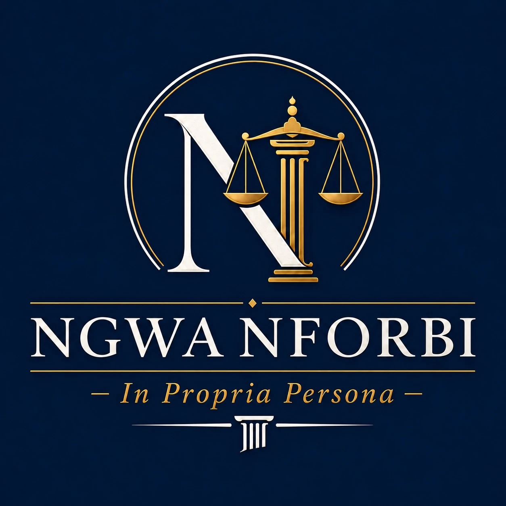

# Interactive Litigation Portfolio

An interactive, single-page litigation dashboard for **Brendan Ngehsi Newanforbi**, Pro Se / In Propria Persona. The portfolio tracks 33 civil matters across federal and California state courts, providing a structured view of case status, procedural history, damages exposure, and overarching legal theories.

**Live site:** [interactive-litigation-portfolio.vercel.app](https://interactive-litigation-portfolio.vercel.app)

<br clear="left" />

## Contents

- [Overview](#overview)
- [Case Clusters](#case-clusters)
  - [1 — CHP Traffic Stop, DUI Arrest & DMV APS Challenge](#cluster-1--chp-traffic-stop-dui-arrest--dmv-aps-challenge-matters-1-2-7-8-20-24-32-33)
  - [2 — Parole Retaliation, HOPE Abuse & Policy 19-03](#cluster-2--parole-retaliation-hope-abuse--policy-19-03-matters-36-11-1318-21-28-30)
  - [3 — Consumer Fraud / Defective Vehicle](#cluster-3--consumer-fraud--defective-vehicle-matter-12)
  - [4 — Administrative Writs & Habeas Corpus](#cluster-4--administrative-writs--habeas-corpus-matters-9-10-19)
  - [5 — Employment / Statutory Violation](#cluster-5--employment--statutory-violation-matters-22-25-26-27-29-31)
- [All Matters](#all-matters)
- [Upcoming Deadlines](#upcoming-deadlines)
- [Damages Summary](#damages-summary)
- [Attorney Fees Analysis](#attorney-fees-analysis)
- [Legal Theories](#legal-theories)
- [Tech Stack](#tech-stack)
- [Citation Verification](#citation-verification)
- [Local Development](#local-development)
- [Build](#build)
- [Deployment](#deployment)

---

## Overview

<!-- PORTFOLIO:OVERVIEW_TABLE:START -->
| Field | Detail |
|---|---|
| Plaintiff | Brendan Ngehsi Newanforbi |
| Representation | Pro Se / In Propria Persona |
| Jurisdictions | USDC E.D. Cal., USDC N.D. Cal., San Joaquin Sup. Ct., Alameda Sup. Ct., Sacramento Sup. Ct., Santa Clara Sup. Ct. |
| Total Matters | 34 |
| Active / Open | 15 |
| — of which Settled | 1 (Matter 22 — Newanforbi v. Pilot Travel Centers LLC, Jul. 14, 2026) |
| Dismissed / Closed / Abandoned | 19 |
| Aggregate Exposure (Conservative) | ~$1,161,000+ |
| Aggregate Exposure (Moderate) | ~$2,957,000+ |
| Aggregate Exposure (Aggressive) | ~$6,579,000+ |
| Last Updated | August 8, 2026 |
<!-- PORTFOLIO:OVERVIEW_TABLE:END -->

<!-- PORTFOLIO:CLOSED_COUNT_NOTE:START -->
*Of the 19 dismissed/closed/abandoned matters: 7 abandoned, 10 dismissed, 2 otherwise closed (structured `lifecycle` on each matter JSON). See [All Matters](#all-matters) below for the full disposition table. Pre-filing matters stay in the Active table.*
<!-- PORTFOLIO:CLOSED_COUNT_NOTE:END -->

> **Housing status:** Homeless since July 2, 2026 — a direct consequence of a retaliatory inter-county parole transfer (Stockton → Santa Clara) imposed immediately after filing Matter 15 (*Newanforbi v. CDCR, et al.*). The transfer caused loss of Stockton family housing; Matters 3, 9, and 19 are also potential retaliatory predicate acts.
>
> **Cost of self-representation:** All 33 matters are self-litigated. Estimated equivalent private-counsel cost: **$799,904–$1,324,176** (see [Attorney Fees Analysis](#attorney-fees-analysis)).

[↑ Contents](#contents)

---

## Case Clusters

### Cluster 1 — CHP Traffic Stop, DUI Arrest & DMV APS Challenge (Matters 1, 2, 7, 8, 20, 24, 32, 33)

Arising from a November 1, 2024 CHP encounter on I-580. Officers arrested Plaintiff after he declined an optional PAS test, despite dashcam footage contradicting the DUI report's fabricated observations. No charges were filed; a PC §849(b)(1) Detention Certificate followed on November 5, 2024; a 5-day parole hold and a one-year Class A CDL suspension (APS Case 34739340) followed. The cluster now spans eight matters — six historical dockets plus two N.D. Cal. filings opened August 7, 2026:

- **Matter 1** (USDC E.D. Cal.): Federal §1983 against CHP officers; adverse F&R issued April 20, 2026 (Magistrate CSK recommends MTD GRANTED WOLA — 4th/14th Amendment, qualified immunity); District Judge DC adoption pending. If adopted, Matter 2 (Alameda, stayed) and the new Matter 32 N.D. Cal. filing become the primary vehicles.
- **Matter 2** (Alameda Sup. Ct.): Parallel state tort action (False Imprisonment, Battery, Bane Act); STAYED pending Matter 1 District Judge ruling.
- **Matter 7** (USDC E.D. Cal.): Federal §1983 against DMV Hearing Officer Candelaria and DMV Director Gordon; adverse F&R issued June 15, 2026 (Magistrate CSK: IFP denied as frivolous; FAC dismissed WOLA). Portfolio record still shows F&R pending on objections; Matter 33's operative N.D. Cal. complaint alleges Matter 7 was voluntarily dismissed without prejudice — confirm the E.D. Cal. docket before treating either posture as controlling.
- **Matter 8** (Sacramento Sup. Ct.): State Writ of Administrative Mandate challenging the same void APS decision — **ABANDONED** after the July 17, 2026 fee-waiver hearing (non-appearance) and the ~July 27, 2026 fee-payment deadline lapsed. PDFs live under Matter 33 (`matter-33/from-08/`).
- **Matter 20** (Alameda Sup. Ct.): State Writ of Mandate against CHP; demurrer opposition filed July 13, 2026; CHP demurrer hearing Aug. 28, 2026. Individual Respondents Serrato, Paul, and Dutra filed joinders/demurrers July 30, 2026 and stipulated to advance their Oct. 16/23 hearing dates to Aug. 28 (stipulation not yet entered).
- **Matter 24** (USDC N.D. Cal.): §1983 against San Mateo Sheriff Deputy Serrato for arbitrary U Visa certification denial and retaliation; IFP granted June 29, 2026 (Krishnan screening order, now cited across the cluster); CMC September 15, 2026. Listed as related case on the Matter 32/33 JS-44s.
- **Matter 32** (USDC N.D. Cal.): **CASE FILED August 7, 2026, 4:05 p.m. PT** — *Nforbi v. Meza-Gonzalez & Melano*, §1983 (six causes: unlawful entry/search/arrest, Franks/judicial deception, fabrication, First Amendment retaliation); compensatory damages >$214,000 pleaded; case number assignment pending. Also owns the Meza-Gonzalez / CHP-cluster docket PDFs from Matters 1, 2, 20, and 24 under `matter-32/from-01|02|20|24/` and the new N.D. Cal. filing set under `matter-32/ndcal/`.
- **Matter 33** (USDC N.D. Cal.): **CASE FILED August 7, 2026, 4:05 p.m. PT** — *Ngwa Nforbi v. Candelaria, et al*, §1983 APS structural-bias / fair-hearing / vacatur (five causes); compensatory damages >$214,000 and JS-44 demand $250,000 min.; case number assignment pending. Also owns the Nov. 1 / APS incident evidence (`matter-33/incident/`), Matter 7 PDFs (`from-07/`), Matter 8 PDFs (`from-08/`), the June 15, 2026 Candelaria F&R (`opinions/`), and the N.D. Cal. filing set under `matter-33/ndcal/`.

### Cluster 2 — Parole Retaliation, HOPE Abuse & Policy 19-03 (Matters 3–6, 11, 13–18, 21, 28, 30)

The largest cluster — 14 matters — targeting CDCR's parole supervision apparatus, the HOPE Psychotherapy program, and constitutional violations across parole travel, housing, and employment decisions. Core allegations include:

- **First Amendment retaliation** by Agent Derrick, who suppressed speech and sabotaged Plaintiff's FedEx employment; explicit "you do not have freedom of speech" statement satisfies *Rhodes v. Robinson*.
- **Retaliatory inter-county transfer** on July 2, 2026 — supervision moved from San Joaquin to Santa Clara County immediately after filing Matter 15 naming Supervising Agent Noguchi; caused loss of Stockton family housing and employment; Plaintiff has been **homeless since July 2, 2026**. Matters 3, 9, and 19 are also potential retaliatory predicate acts for the transfer.
- **HOPE's structural fee incentive** (~$9,690–$10,600/year per parolee at standard billing rates; condemned in *In re Dwyer*, SC-080355A, San Mateo County Super. Ct., Mar. 20, 2023) with no completion credit — financial incentive to retain rather than discharge.
- **HOPE's blanket retention policy** requiring the full parole term regardless of clinical progress — documented in HOPE's own Clinical Operational Manual (HOPE_000294) and condemned in *In re Dwyer*; now forms the Monell theory in Matter 28.
- **Retaliatory reporting** — false no-shows logged and adverse CDCR Form 3043 reports directed by Shannon Smith; HOPE_000142/194 (produced in Matter 5) documents a no-show logged despite agent-confirmed technical error.
- **Facially defective Discharge Review** (November 2025) containing a copy-paste error naming "Eagan" rather than Plaintiff; fabricated 6.5-year retention minimum sourced from academic research rather than statute; unemployment (caused by Defendants' own conduct) cited as aggravating factor.
- **Policy 19-03** enforced after 15 CCR § 3574 superseded it in April 2025 — ultra vires categorical bar.
- Documented CDL career wage losses: $109,408 across 6 carriers (W-2 verified, 2022–2024).
- **Matter 5 (Palacios)** — state action disposed July 15, 2026 (demurrer sustained, exhaustion grounds); 542 pages of HOPE discovery (Bates HOPE_000001–542) produced before dismissal are now carried into **Matter 28** via Motion for Protective Order.
- **Matter 15** (San Joaquin Sup. Ct., STK-CV-UPI-2026-5417) — **ABANDONED.** Would have asserted Negligence, False Imprisonment, IIED, and Breach of Mandatory Duty against CDCR, Dodd, and Noguchi — the highest single-matter exposure in the portfolio. Complaint was filed and both individual defendants personally served; a responsive-pleading extension had been agreed with Deputy Attorney General Judith S. Gronna. Voluntarily dismissed with prejudice as to all defendants on July 24, 2026 due to a real, credible safety threat — unrelated to the Matter 19 habeas ruling.
- **Matter 28** (USDC N.D. Cal., Case No. 3:26-cv-07504, Hon. Lisa J. Cisneros): Federal successor; §1983 Monell (HOPE) + Individual Capacity (Shannon Smith, LCSW), Bane Act §52.1, Fraud/Negligent Misrepresentation, RICO 18 U.S.C. §1962(c)-(d); case filed July 20, 2026, Initial CMC set October 22, 2026. **Insured exposure: $1M per incident / $5M aggregate** — Philadelphia Indemnity Policy No. 067968, produced in Matter 5 discovery, covering HOPE Psychotherapy, Inc. and Shannon Smith, LCSW. This is the only carrier-funded floor in the portfolio: it does not depend on either defendant's balance sheet, and because the per-incident limit is one-fifth of the aggregate, pleading discrete violations rather than one omnibus claim is what reaches the full tower. Shannon Smith's individual-capacity exposure sits outside the corporate tower, adding personal settlement pressure on top of it.
- **Matter 30** (USDC N.D. Cal., San Jose Div.) — **PENDING (pre-complaint), filing contingent on parole discharge.** Asserts §1983 First Amendment Retaliation + Due Process, Bane Act §52.1, and IIED against Long Moua (Badge #7472), for the November 14, 2025 retaliatory 1502-DR and the July 2, 2026 inter-county parole transfer; Government Claims Act claim filed July 18, 2026, anticipated deemed-rejected September 1, 2026. This matter is not abandoned: Plaintiff intends to file it if discharged from CDCR parole supervision before its filing window closes, notwithstanding the safety-driven caution that led to abandoning the companion matters below. Outer deadline for the state-law claims is on or about March 1, 2027 (Gov. Code §945.6(a)(1), six months from the deemed rejection); the §1983 claims run on the longer two-year limitations period.
- **Matters 3, 4, 14, 16 (Derrick, Urrea, Rojo)** — all **ABANDONED** due to a real, credible safety threat. Matter 3's federal MTD was under submission at the time of withdrawal; Defendant Palacios's exposure survives independently through Matter 5's discovery record and Matter 28. Matters 6, 11, 13, 17, 18, and 21 — the federal §1983 companion suits against HOPE, Macomber, Urrea, Maloney, and Barocio, all filed the week of January 22, 2026 — were voluntarily dismissed (five with prejudice, together, on June 29, 2026) once the surviving vehicles above made the parallel federal claims unnecessary.

### Cluster 3 — Consumer Fraud / Defective Vehicle (Matter 12)

Fraud and UCL claims against Diamond Truck Sales, Inc. and Alpine Truck Sales, Inc. for concealing a DEF/emissions defect and prior CHP out-of-service order on a 2014 Volvo VNL (VIN: 4V4NC9EH6EN142206) purchased for $26,900. The truck entered catastrophic derate mode immediately after purchase, rendering it commercially unusable. Direct documented losses ~$25,129.44; lost hauling income >$46,800. Diamond Truck Sales, Inc. served March 11, 2026 — no response filed; default judgment request submitted June 15, 2026. Alpine Truck Sales, Inc. personally served July 1, 2026 (Mustagem Usmani, Manager, 1201 S Soderquist Road, Turlock); response deadline July 31, 2026; no meet-and-confer contact received. Request for Default Judgment pre-drafted. CMC: August 12, 2026, 8:30 AM, Dept. 11B, Hon. Robert T. Waters.

**Expected recovery — favorable August 12, 2026 CMC:** With both named defendants in default (Diamond since April 10, 2026; Alpine deadline July 31, 2026 — before CMC), the August 12 hearing is the prove-up entry point. A favorable ruling is expected to yield:

| Component | Amount |
|---|---|
| Documented Out-of-Pocket (deposit $12,345.10 + GAP $1,895 + DMV $3,442 + Brannon Tire $1,197.34 + Mobile Will's $740 + Golden Empire Towing $562.50 + Western Truck Center $36.71) | $20,218.65 |
| Undocumented Out-of-Pocket, sworn testimony (Commercial Towing $750 + Almaraz Diesel $5,000) | $5,750.00 |
| Lost Commercial Hauling Income (18 wks × $1,300/wk; Amazon Relay carrier agreement on file) | $23,400.00 |
| Prejudgment Interest (Civ. Code §3287(a); 7% × ~3.04 yrs on documented losses) | $4,302.55 |
| **Compensatory Subtotal (per Declaration ISO Default Judgment, filed June 15, 2026)** | **$53,671.20** |
| Punitive Damages (Civ. Code §3294; fraudulent concealment + intentional misrepresentation; Diamond→Alpine rebrand as consciousness-of-liability badge) | ≥ $25,000.00 |
| Costs of Suit (per Form MC-010 — filing fees, sheriff's service fees, etc.) | per MC-010 |
| **Total Monetary Judgment Requested (per Default Judgment Packet)** | **≥ $78,671.20 + costs** |

*The $78,671.20 floor is established in the Declaration ISO Default Judgment filed June 15, 2026 against Diamond Truck Sales, Inc. Punitive damages and costs are subject to judicial discretion at the August 12, 2026 prove-up hearing. Lost income was deliberately underpled at 18 weeks (conservative) versus the FAC's $46,800+ allegation; FAC paragraph 31 controls the Greenup v. Rodman notice ceiling on lost income.*

**Post-judgment collection prep (as of July 29, 2026 — no judgment entered yet):** EJ-001 (Abstract of Judgment), EJ-130 (Writ of Execution), AT-138/EJ-125 (Judgment Debtor Examination), and MC-012 (Memorandum of Costs After Judgment) are pre-drafted with the case's fixed facts (parties, court, case number) already filled in, so they're ready to complete and file the same day or next business day once the Aug. 12 CMC actually produces a judgment — no field asserts a judgment date or amount that hasn't happened. Alpine's joint-and-several exposure runs through its own pre-drafted default judgment packet (CIV-100, execution date Aug. 1, 2026), not a CCP §187 motion to amend the judgment — §187 amendment adds an alter ego who was never a named party, and generally isn't available where the underlying judgment is by default; Alpine is already a named, personally-served defendant, so its own default judgment is the correct vehicle.

**Default judgment packet review findings (flagged Jul. 29, 2026):**
- **Case number error** — every CIV-100 in both the Diamond and Alpine default judgment packets, and the original [Proposed] Judgment (JUD-100), showed the case number as `STK-CV-UF-2026-1094` instead of the actual `STK-CV-UF-2026-0001094`. The JUD-100 has been corrected (new file in the documents list, ready to submit at the Aug. 12 CMC) and also now names Alpine — not just Diamond — in Item 5a's operative "against defendant" field, since the original only mentioned Alpine's joint-and-several liability in freeform Item 8 text, which the abstract-of-judgment and writ-of-execution forms aren't built to read. Diamond's CIV-100/Declaration were already submitted to the court on 6/15/26 with the case-number error baked in — that can't be fixed by editing a repository copy; confirm with the clerk that the case docketed correctly, and fix Alpine's CIV-100 before it's filed Aug. 1.
- **"Osmani" vs. "Usmani"** — Alpine's own Declaration ISO Default Judgment (¶6) cites "the same Osmani family ownership and management" as part of the sworn evidentiary basis for the alter-ego/successor theory, but the only individual named anywhere else in the service record is Usmani (spelled two ways: "Mustagem" and "Mustaqem"). Confirm which name is correct before it's relied on further — this is now inside a sworn filing, not just outside planning notes.
- **Standing question on the lost-income claim** — the Lease-On Owner Operator Agreement behind the $23,400 lost-income figure is contractually between Gobbato Builders, LLC and a separate registered entity, "Altamont Freight LLC" (confirmed by its own W-9 and Amazon Relay driver roster, at a different Modesto address), not personally Brendan Ngwa Nforbi, though the Declaration frames the loss as his personally. Unlikely to be caught in an uncontested default prove-up, but worth resolving before relying on it in a contested posture.
- **DMV fee vs. pending use-tax exemption** — the $3,442 DMV fee claimed in full as damages includes ~$2,421 in CA use/city-use tax that a CDTFA exemption request in the same exhibit set sought to avoid; the Declaration doesn't disclose whether that exemption was granted, which could reduce the true out-of-pocket DMV obligation if it was.

**Bank levy prep (added Jul. 29, 2026; central-location question resolved Jul. 29, 2026):** AT-167/EJ-152 Memorandum of Garnishee — the form a garnishee bank returns to the levying officer disclosing what it holds, not a notice-of-levy instrument the creditor serves — has been caption-prefilled for both known target institutions (Bank of Stockton and JPMorgan Chase) against both Diamond and Alpine, four draft copies total, items 3–9 left blank for the bank to complete. Garnishee addresses used are each bank's Turlock branch nearest 1201 S Soderquist Road (Bank of Stockton, 134 S Golden State Blvd; Chase, 2951 Countryside Dr).

Both banks almost certainly exceed the 9-branch threshold under CCP §684.115, which requires financial institutions with more than nine California branches to designate a single central location for levy service statewide, filed with DFPI. DFPI's actual *Central Locations for Service of Legal Process* registry was obtained and searched in full (every cell, not just institution-name matches): **neither JPMorgan Chase Bank, N.A. nor Bank of Stockton has ever filed a designation.** The registry isn't limited to DFPI-licensed institutions — it includes other OCC-chartered national banks (e.g., American Plus Bank, N.A.; Chino Commercial Bank, N.A.), so the absence isn't a charter-type artifact. Under §684.115's default rule, a financial institution that fails to designate has *every* California branch deemed a valid central location for service. Net effect: the two Turlock branches above are legally valid levy targets for both banks as-is; no further address confirmation is needed. (Registry caveat: DFPI's file was last updated with new filings through Sep. 22, 2025, so a designation filed after that date wouldn't appear — low residual risk here since neither bank has any filing history at all, not a recently-lapsed one. Bank of Stockton's separate DFPI *regulated-entity* listing, a different dataset entirely, confirms its license and HQ at 301 East Miner Avenue, Stockton — supporting context, not a substitute for the central-locations finding.)

None of this is actionable yet regardless: it depends on the Writ of Execution (EJ-130) actually issuing, which requires a judgment first.

### Cluster 4 — Administrative Writs & Habeas Corpus (Matters 9, 10, 19)

Three equitable proceedings seeking court orders directing CDCR to act — no tort damages sought. Two are now closed; one remains active:

- **Matter 9** (Sacramento Sup. Ct., 26WM000028): Writ of Mandate — **CLOSED**. Demurrer sustained without leave to amend May 29, 2026 (Hon. James P. Arguelles, Dept. 13A): CDCR has no duty under Pen. Code §3008 to conduct an individualized EDC assessment where §3000(b)(2)(B) mandates a 10-year parole term; habeas corpus is the correct vehicle. The substantive claim is live in Matter 19.
- **Matter 10** (Santa Clara Sup. Ct., C2602632): Habeas Corpus — **CLOSED**. Petition denied without prejudice April 27, 2026 (exhaustion; PC §3008(d)(2) certification required).
- **Matter 19** (Santa Clara Sup. Ct., C2604791): Habeas Corpus — **ACTIVE**. Seeks immediate and unconditional discharge from parole; filed April 3, 2026; Order Extending Time issued July 2, 2026 (Hon. Robert Hawk) setting a ruling deadline of August 1, 2026. **That deadline lapsed without a ruling** — as of August 7, 2026 Judge Hawk has not ruled and no further extension order has issued. The petition remains pending and under submission; it has not been denied, dismissed, or set for an Order to Show Cause. An HC-004 request-for-ruling packet was prepared August 7, 2026 and is ready to file.

### Cluster 5 — Employment / Statutory Violation (Matters 22, 25, 26, 27, 29, 31)

Five matters asserting Penal Code § 290.46(j)(2)(E) — the categorical prohibition on using sex offender registry information for employment purposes — against separate employers across a 30-month window, plus a sixth matter (31) asserting vendor-side FCRA/ICRAA liability against the background-check company that supplied two of those registry-flagged reports. (Matters 32 and 33 are CHP / DMV APS filings — see Cluster 1.)

- **Matter 22** (Newanforbi v. Pilot Travel Centers LLC) — **SETTLED July 14, 2026** — San Joaquin Superior Court (STK-CV-UWT-2026-0007649). Wrongful termination; Defendant's own Post-Adverse Action Notice admitted registry as sole termination basis. Resolved pro se in under seven weeks from filing, before service was completed. First portfolio settlement. Closing out August 2026: CM-200 Notice of Settlement / CIV-110 request for dismissal mailed August 3, 2026; POS completed August 5, 2026.
- **Matter 25** (Newanforbi v. Federal Express Corporation) — San Joaquin Superior Court (STK-CV-UWT-2026-0009118); PC §290.46(j) failure to hire; First Advantage BGC ran March 2025; final adverse action March 19, 2025; complaint filed July 15, 2026; assigned to Dept. 10B, Hon. Blanca Banuelos; CMC January 14, 2027. **SERVED July 24, 2026** on Ct Corporation System; responsive pleading due August 24, 2026.
- **Matter 26** (Newanforbi v. United Parcel Service, Inc.) — San Joaquin Superior Court (STK-CV-UWT-2026-0009113); PC §290.46(j) failure to hire; First Advantage BGC ran July 2024; final adverse action July 31, 2024; complaint filed July 15, 2026 — **2-year limitations period preserved (filed 16 days ahead of the July 31, 2026 cutoff)**; assigned to Dept. 11B, Hon. Robert T. Waters; CMC January 13, 2027. **SERVED July 22, 2026**; responsive pleading due August 21, 2026.
- **Matter 27** (Newanforbi v. Randstad US, LLC and RK Logistics Group, Inc.) — Alameda Superior Court, Case No. **26CV199902**, Hon. Karin Schwartz, Dept. 20; PC §290.46(j) / FCRA / ICRAA / Tameny wrongful termination. Rehired July 7, 2026; InfoMart BGC shows Billing Code "RK LOGISTICS" with registry as the sole adverse flag; Randstad terminated July 15, 2026, two business days after the FCRA pre-adverse notice. Verified Complaint e-filed July 20, 2026. **On July 21, 2026, RK Logistics denied the $85,000 demand through counsel Garcia & Gurney, ALC**, arguing (1) Randstad was the employer and (2) the rejection was MVR-based — neither ground reaches Randstad, and the MVR defense cites a commercial Class A disqualification inapplicable to the Class C position. **SERVED July 30, 2026** on both defendants; responsive pleading due August 31, 2026.
- **Matter 29** (Newanforbi v. Amazon.com Services, LLC and Accurate Background LLC) — Alameda Superior Court, Case No. **26CV201554**, Hon. Jamilah Jefferson, Dept. 520; PC §290.46(j) / Fair Chance Act (Gov. Code §12952) / FCRA / ICRAA / UCL / IIED. **CASE FILED July 28, 2026**; **BOTH DEFENDANTS SERVED July 31, 2026** (Amazon via Sacramento County Sheriff; Accurate Background via private process server). Responsive pleading due August 31, 2026. Fee-waiver hearing set August 18, 2026 (Dept. FHO) — Plaintiff paid the $435 filing fee August 3, 2026 and requested the hearing be taken off calendar as moot. CCP §425.115 punitive-damages notices drafted August 7, 2026 ($250,000 Amazon / $100,000 Accurate Background), not yet served. **Lerma posture (corrected):** in *Lerma v. Amazon.com Services, LLC et al.*, No. 8:22-cv-01727 (C.D. Cal.), the PC §290.46(j) claim was **dismissed at the pleading stage (May 26, 2023)**; the case later settled (Sept. 29, 2023) on a surviving Fair Chance Act claim against Amazon only — useful Fair Chance / notice precedent, not a settled Megan's Law judgment against these defendants.
- **Matter 31** (Newanforbi v. First Advantage LLC) — anticipated San Joaquin Superior Court; FCRA §1681b(b) / FCRA §1681e(b) / ICRAA / Negligence Per Se / UCL §17200. **Identified July 30, 2026 via portfolio gap analysis**; not yet filed and no demand letter sent. First Advantage generated the registry-flagged reports underlying Matters 25 and 26 — additive vendor liability, not a duplicate of the employer-side claims.

[↑ Contents](#contents)

---

## All Matters

### Active / Open

<!-- PORTFOLIO:ACTIVE_MATTERS:START -->
| # | Caption | Case No. | Court | Type | Status |
|---|---|---|---|---|---|
| 12 | Brendan Ngwa Nforbi v. Diamond Truck Sales, Inc. | STK-CV-UF-2026-0001094 | San Joaquin Sup. Ct. | State | Defense appeared, disputes service — CMC Dec. 11, 2026 |
| 19 | Newanforbi v. Macomber | C2604791 | Santa Clara Sup. Ct. | State | HC-004 refreshed Aug. 17 — ruling overdue since Aug. 1, 2026 |
| 20 | Newanforbi v. California Highway Patrol, et al. | 26CV191136 | Alameda Sup. Ct. | State | Demurrer hearing Aug. 28, 2026 — CMC continued to Sep. 2 |
| 22 | Newanforbi v. Pilot Travel Centers LLC | STK-CV-UWT-2026-0007649 | San Joaquin Sup. Ct. | State | Settled Jul. 14, 2026 ($35,000) |
| 24 | Newanforbi v. Serrato | 4:26-cv-05953-ASK | USDC N.D. Cal. | Federal | Served Aug. 5, 2026 — answer due Aug. 26; CMC Sep. 15 |
| 25 | Newanforbi v. Federal Express Corporation | STK-CV-UWT-2026-0009118 | San Joaquin Sup. Ct. | State | Served Jul. 24, 2026 — response due Aug. 24 |
| 26 | Newanforbi v. United Parcel Service, Inc. | STK-CV-UWT-2026-0009113 | San Joaquin Sup. Ct. | State | Served Jul. 22, 2026 — response due Aug. 21 |
| 27 | Newanforbi v. Randstad, et al. | 26CV199902 | Alameda Sup. Ct. | State | RK response Aug. 31 — Randstad extended to Sep. 15 |
| 28 | Newanforbi v. Shannon Smith, LCSW, CEO, et al. | 3:26-cv-07504 | USDC N.D. Cal. | Federal | Fee paid — CMC Oct. 22, 2026; SPO denied w/o prejudice |
| 29 | Newanforbi v. Amazon.com Services, LLC | 26CV201554 | Alameda Sup. Ct. (Hayward Hall of Justice, Dept. 520) | State | Fee paid / notices e-filed Aug. 6 — response due Aug. 31 |
| 30 | Newanforbi v. Moua, et al. | TBD | USDC N.D. Cal. | Federal | Pre-filing — GCA claim pending; Moua-only complaint ready |
| 31 | Newanforbi v. First Advantage LLC | TBD | San Joaquin Sup. Ct. (anticipated) | State | Pre-filing |
| 32 | Nforbi v. Meza-Gonzalez, et al | 3:26-cv-08271-PHK | USDC N.D. Cal. (docketed Aug. 10, 2026; related Serrato 4:26-cv-05953-ASK and Candelaria 3:26-cv-08272-LJC) | Federal | Served Aug. 14, 2026 — response due Sep. 4; CMC Dec. 2 |
| 33 | Nforbi v. Candelaria et al. | 3:26-cv-08272-LJC | USDC N.D. Cal. (San Francisco Div.) | Federal | Served Aug. 14, 2026 — response due Sep. 4; CMC Nov. 12 |
| 34 | Newanforbi v. Counseling and Psychotherapy Center, Inc., et al. | TBD | USDC N.D. Cal. (San Jose Div.) / Santa Clara Sup. Ct. | Federal | Pre-filing — intake & compliance monitoring |
<!-- PORTFOLIO:ACTIVE_MATTERS:END -->

*Settled matters stay in the table above until dismissal is entered — a settlement resolves the merits, but the matter is still open on the docket. Their Status column reads "Settled" (see the Overview count above for which ones).*

### Dismissed / Closed / Archived

*Matters marked **ABANDONED** were voluntarily withdrawn due to real, credible safety threats.*

<!-- PORTFOLIO:CLOSED_MATTERS:START -->
| # | Caption | Case No. | Court | Disposition |
|---|---|---|---|---|
| 1 | Newanforbi v. CHP et al. | 2:25-cv-01460-DC-CSK | USDC E.D. Cal. | Dismissed w/o prejudice — Aug. 15; refiled as Matter 32 |
| 2 | Newanforbi v. Meza-Gonzalez et al. | 26CV168913 | Alameda Sup. Ct. | Dismissed w/o prejudice — Aug. 15, 2026 |
| 3 | Newanforbi v. Derrick et al. | 2:26-cv-00004-DJC-JDP | USDC E.D. Cal. | Abandoned — MTD granted, FAC leave to amend Jul. 24, 2026 |
| 4 | Newanforbi v. Derrick et al. | TBD | San Joaquin Sup. Ct. | Abandoned — voluntarily dismissed |
| 5 | Newanforbi v. Palacios et al. | STK-CV-UF-2026-0001032 | San Joaquin Sup. Ct. | Dismissed — demurrer sustained w/o leave Jul. 15, 2026 |
| 6 | Newanforbi v. HOPE et al. | 2:26-cv-00195-TLN-AC | USDC E.D. Cal. | Dismissed without prejudice — Jun. 1, 2026 |
| 7 | Newanforbi v. Candelaria | 2:26-cv-00983-DC-CSK | USDC E.D. Cal. | Dismissed w/o prejudice — Aug. 15; refiled as Matter 33 |
| 8 | Newanforbi v. Candelaria, et al. | 26WM000135 | Sacramento Sup. Ct. | Abandoned — fee-payment deadline lapsed Jul. 27, 2026 |
| 9 | Newanforbi v. Macomber | 26WM000028 | Sacramento Sup. Ct. | Closed — demurrer sustained May 29, 2026 |
| 10 | Newanforbi v. Macomber | C2602632 | Santa Clara Sup. Ct. | Closed — petition denied w/o prejudice Apr. 27, 2026 |
| 11 | Newanforbi v. Macomber | TBD (USDC E.D. Cal.) | USDC E.D. Cal. | Dismissed with prejudice — Jun. 29, 2026 |
| 13 | Newanforbi v. Urrea et al. | 2:26-cv-00190-DC-SCR | USDC E.D. Cal. | Dismissed with prejudice — Jun. 29, 2026 |
| 14 | Newanforbi v. Urrea et al. | TBD (San Joaquin Sup. Ct.) | San Joaquin Sup. Ct. | Abandoned — voluntarily dismissed |
| 15 | Newanforbi v. California Department of Corrections and Rehabilitation, et al. | STK-CV-UPI-2026-5417 | San Joaquin Sup. Ct. | Abandoned — dismissed with prejudice Jul. 24, 2026 |
| 16 | Newanforbi v. Rojo | TBD (San Joaquin Sup. Ct.) | San Joaquin Sup. Ct. | Abandoned — voluntarily dismissed |
| 17 | Newanforbi v. Maloney et al. | 2:26-cv-00194-DAD-SCR | USDC E.D. Cal. | Dismissed with prejudice — Jun. 29, 2026 |
| 18 | Newanforbi v. Barocio | 2:26-cv-00191-DJC-CSK (PC) | USDC E.D. Cal. | Dismissed with prejudice — Jun. 29, 2026 |
| 21 | Newanforbi v. Rojo et al. | 2:26-cv-00193-DC-CKD | USDC E.D. Cal. | Dismissed with prejudice — Jun. 29, 2026 |
| 23 | Newanforbi v. Macy's Inc. et al. | TBD | San Joaquin Sup. Ct. | Abandoned — no adverse action occurred |
<!-- PORTFOLIO:CLOSED_MATTERS:END -->

[↑ Contents](#contents)

---

## Upcoming Deadlines

*Generated from `timeline` entries with `upcoming: true`.*

<!-- PORTFOLIO:UPCOMING_DEADLINES:START -->
| Date | Matter | Event |
|---|---|---|
| Aug. 19, 2026 | 27 | Transmit the executed confirmation of the 15-day extension to Randstad's counsel (cwilliams@kcozlaw.com), as his Aug. 18, 2026 email requests — self-imposed next-day target, not a court deadline. |
| Aug. 19, 2026 | 7, 8, 33 | Gov. claim deadline — Candelaria state tort Bane Act damages (6 months from Feb. 19, 2026 accrual; claim must be filed with DGS). Independent of Matter 7's federal case status (dismissed Aug. 15, 2026) |
| Aug. 19, 2026 | 25 | Meet-and-confer deadline (computed) — Newanforbi v. Federal Express Corporation (STK-CV-UWT-2026-0009118) |
| Aug. 21, 2026 | 20 | AG reply deadline (computed) — Respondents' Reply to Petitioner's Opposition to Demurrer due 5 court days before Aug. 28, 2026 hearing per CRC 3.1320(b) — Newanforbi v. California Highway Patrol et al. (26CV191136) |
| Aug. 21, 2026 | 26 | Responsive pleading deadline (computed) — Newanforbi v. United Parcel Service, Inc. (STK-CV-UWT-2026-0009113); 30 days from the Jul. 22, 2026 service date (CCP §412.20(a)(3)) |
| Aug. 24, 2026 | 25 | Responsive pleading deadline (computed) — Newanforbi v. Federal Express Corporation (STK-CV-UWT-2026-0009118); 30 days from the Jul. 24, 2026 service date (CCP §412.20(a)(3)) |
| Aug. 25, 2026 | 27 | Outer target to transmit the opening settlement demand to Randstad's counsel — drafted and executed Aug. 18, 2026 at $250,000.00 as to Randstad alone, with a Sept. 8, 2026 response deadline built into the letter. |
| Aug. 25, 2026 | 24 | Deadline — ADR Certification (ADR L.R. 3) and Rule 26(f) meet-and-confer (initial disclosures, early settlement, ADR process selection, discovery plan) — Newanforbi v. Serrato (4:26-cv-05953-ASK) |
| Aug. 26, 2026 | 27 | Meet-and-confer deadline (computed) as to The RK Logistics Group, Inc. — Newanforbi v. Randstad US, LLC et al. (26CV199902) |
| Aug. 26, 2026 | 29 | Meet-and-confer deadline (computed) — Newanforbi v. Amazon.com Services, LLC, et al. (26CV201554) |
| Aug. 26, 2026 | 24 | Responsive pleading deadline (computed) — Newanforbi v. Serrato (4:26-cv-05953-ASK); 21 days from the Aug. 5, 2026 USMS personal service date (FRCP 12(a)(1)(A)) |
| Aug. 28, 2026 | 20 | Demurrer Hearing — Newanforbi v. California Highway Patrol et al. (26CV191136), 9:00 a.m., Dept. 25, Rene C. Davidson Courthouse, Oakland; Hon. Jenna M. Whitman |
| Aug. 31, 2026 | 27 | Responsive pleading deadline (computed) — The RK Logistics Group, Inc. only, Newanforbi v. Randstad US, LLC et al. (26CV199902); 30 days from the Jul. 30, 2026 service date (CCP §412.20(a)(3)) |
| Aug. 31, 2026 | 29 | Responsive pleading deadline (computed) — Newanforbi v. Amazon.com Services, LLC, et al. (26CV201554); 30 days from the Jul. 31, 2026 service date on both defendants (CCP §412.20(a)(3)) |
| Sep. 1, 2026 | 30 | Anticipated deemed-rejection date (computed) — Government Claims Act claim, Newanforbi v. Moua, et al. (Matter 30) |
| Sep. 2, 2026 | 20 | Case Management Conference (continued from Jul. 15, 2026) — Newanforbi v. California Highway Patrol, et al. (Case No. 26CV191136), Dept. 25, Rene C. Davidson Courthouse, Oakland, Alameda County; Hon. Jenna M. Whitman |
| Sep. 4, 2026 | 32 | Responsive pleading deadline (computed) — Santiago Meza-Gonzalez and Jose Melano, Nforbi v. Meza-Gonzalez, et al. (3:26-cv-08271-PHK, N.D. Cal.) |
| Sep. 4, 2026 | 33 | Responsive pleading deadline (computed) — Diana Candelaria and Steve Gordon, Nforbi v. Candelaria et al. (3:26-cv-08272-LJC, N.D. Cal.); 21 days from the Aug. 14, 2026 personal service date (FRCP 12(a)(1)(A)(i)). |
| Sep. 8, 2026 | 24 | Deadline — Initial disclosures (FRCP 26(a)(1)) and Joint Case Management Statement — Newanforbi v. Serrato (4:26-cv-05953-ASK) |
| Sep. 10, 2026 | 27 | Meet-and-confer deadline (computed) as to Randstad US, LLC — Newanforbi v. Randstad US, LLC et al. (26CV199902) |
| Sep. 13, 2026 | 25, 26 | Service deadline — Newanforbi v. Federal Express Corporation (STK-CV-UWT-2026-0009118) and Newanforbi v. United Parcel Service, Inc. (STK-CV-UWT-2026-0009113); 60 days from July 15, 2026 filing (CRC 3.110) |
| Sep. 15, 2026 | 27 | Extended responsive-pleading deadline — Randstad US, LLC only, Newanforbi v. Randstad US, LLC et al. (26CV199902); 15 days past the Aug. 31, 2026 computed deadline, agreed on the Aug. 18, 2026 call with Chadwick L. |
| Sep. 15, 2026 | 24 | Initial Case Management Conference — 1:30 PM via Zoom (cand.uscourts.gov/ask); Hon. Ajay S. Krishnan — Newanforbi v. Serrato (4:26-cv-05953-ASK) |
| Sep. 16, 2026 | 30 | Anticipated filing date (computed) — Complaint v9 (Moua and DOES 1-10), Newanforbi v. Moua, et al. (Matter 30); 15 days after the anticipated Sep. 1, 2026 deemed rejection |
| Sep. 26, 2026 | 29 | Service/proof-of-service deadline (computed) — Newanforbi v. Amazon.com Services, LLC, et al. (26CV201554); 60 days from the Jul. 28, 2026 filing (CRC 3.110(b)) |
| Oct. 15, 2026 | 28 | Case Management Statement due — Newanforbi v. Shannon Smith, LCSW, CEO, et al. (3:26-cv-07504), USDC N.D. Cal. |
| Oct. 16, 2026 | 20 | Hearing on CHP demurrer and the individual respondents' joinders/demurrers to the Petition for Writ of Mandate, Newanforbi v. California Highway Patrol, et al. (Matter 20) — Dept. 25 |
| Oct. 22, 2026 | 33 | Deadline to file ADR Certification (ADR L.R. 3) and to meet and confer regarding initial disclosures, early settlement, ADR process selection, and a discovery plan (Fed. R. Civ. P. 26(f)) — Nforbi v. |
| Oct. 22, 2026 | 28 | Initial Case Management Conference — Newanforbi v. Shannon Smith, LCSW, CEO, et al. (3:26-cv-07504), 1:30 PM, Hon. Lisa J. Cisneros, San Francisco (videoconference only) |
| Oct. 23, 2026 | 20 | Continued hearing on the Dutra joinder and demurrer to the Petition for Writ of Mandate, Newanforbi v. California Highway Patrol, et al. (Matter 20) — Dept. 25 |
| Nov. 1, 2026 | 1, 2, 32 | CCP §335.1 two-year statute of limitations (computed) backstop, running from the Nov. 1, 2024 incident. (1) Matter 1's Fourth Amendment §1983 claim (borrowed two-year period): Matter 1 was voluntarily dismissed without… |
| Nov. 5, 2026 | 33 | Deadline to make initial disclosures (Fed. R. Civ. P. 26(a)(1)) and to file the Joint Case Management Statement (Standing Order for All Judges of the Northern District of California) — Nforbi v. |
| Nov. 12, 2026 | 33 | Initial Case Management Conference, 1:30 p.m. by Zoom (cand.uscourts.gov/ljc) before Magistrate Judge Lisa J. Cisneros — Nforbi v. Candelaria et al. (3:26-cv-08272-LJC), set by the Dkt. 4 order. |
| Nov. 12, 2026 | 32 | Deadline to file ADR Certification (ADR L.R. 3) and to meet and confer regarding initial disclosures, early settlement, ADR process selection, and a discovery plan (Fed. R. Civ. P. 26(f)) — Nforbi v. |
| Nov. 25, 2026 | 32 | Deadline to make initial disclosures (Fed. R. Civ. P. 26(a)(1)) and to file the Joint Case Management Statement (Standing Order for All Judges of the Northern District of California) — Nforbi v. |
| Dec. 2, 2026 | 32 | Initial Case Management Conference, 11:00 a.m., Courtroom F, 450 Golden Gate Ave., San Francisco, before Magistrate Judge Peter H. Kang — Nforbi v. Meza-Gonzalez, et al. (3:26-cv-08271-PHK), set by the Dkt. 4 order. |
| Dec. 11, 2026 | 12 | Further Case Management Conference, 8:30 AM, Dept. 11B, Hon. Robert T. Waters — Ngwa Nforbi v. |
| Dec. 14, 2026 | 26 | Meet-and-confer deadline — Newanforbi v. United Parcel Service, Inc. (STK-CV-UWT-2026-0009113); 30 calendar days before Jan. 13, 2027 CMC (CRC 3.724) |
| Dec. 15, 2026 | 25 | Meet-and-confer deadline — Newanforbi v. Federal Express Corporation (STK-CV-UWT-2026-0009118); 30 calendar days before Jan. 14, 2027 CMC (CRC 3.724) |
| Dec. 17, 2026 | 27 | Case Management Conference, Newanforbi v. Randstad US LLC and RK Logistics Group, Inc. (Matter 27) — Hon. Karin Schwartz, Dept. 20, 3:00 p.m. |
| Dec. 29, 2026 | 26 | Case Management Conference Statement due — Newanforbi v. United Parcel Service, Inc. (STK-CV-UWT-2026-0009113); JC Form CM-110, mandatory; 15 days before Jan. 13, 2027 CMC (CRC 3.725) |
| Dec. 30, 2026 | 25 | Case Management Conference Statement due — Newanforbi v. Federal Express Corporation (STK-CV-UWT-2026-0009118); JC Form CM-110, mandatory; 15 days before Jan. 14, 2027 CMC (CRC 3.725) |
| Jan. 6, 2027 | 29 | Case Management Conference — Newanforbi v. Amazon.com Services, LLC, et al. (26CV201554), 10:00 AM, Dept. 520, Hon. Jamilah Jefferson, Hayward Hall of Justice, 24405 Amador Street, Hayward, CA 94544 |
| Jan. 13, 2027 | 26 | Case Management Conference — Newanforbi v. United Parcel Service, Inc. (STK-CV-UWT-2026-0009113), 8:30 AM, Dept. 11B, Hon. Robert T. Waters, San Joaquin Superior Court, 180 E Weber Ave, Stockton, CA 95202 |
| Jan. 14, 2027 | 25 | Case Management Conference — Newanforbi v. Federal Express Corporation (STK-CV-UWT-2026-0009118), 8:45 AM, Dept. 10B, Hon. Blanca Banuelos, San Joaquin Superior Court, 180 E Weber Ave, Stockton, CA 95202 |
| Mar. 1, 2027 | 30 | OUTER STATUTE OF LIMITATIONS (computed) — Government Claims Act six-month suit-filing window for the Bane Act and IIED state-law claims, Newanforbi v. Moua, et al. (Matter 30) |
<!-- PORTFOLIO:UPCOMING_DEADLINES:END -->

[↑ Contents](#contents)

---

## Damages Summary

<!-- PORTFOLIO:DAMAGES_SUMMARY:START -->
| Category | Matters | Conservative | Moderate | Aggressive |
|---|---|---|---|---|
| Lost Wages / Economic Harm | 1, 2, 7, 22 | $20,000 | $130,000 | $334,000 |
| False Imprisonment | 1, 2 | $40,000 | $85,000 | $215,000 |
| Emotional Distress | 1, 2, 5, 7, 22, 24 | $0 | $20,000 | $115,000 |
| Bane Act / Treble | 1, 2 | $15,000 | $50,000 | $70,000 |
| Punitive Damages | 1, 2, 7, 22, 24 | $30,000 | $120,000 | $450,000 |
| Consumer Fraud | 12 | $78,672 | $110,072 | $200,272 |
| Attorneys' Fees | 1, 7, 22, 24 | $28,000 | $45,000 | $70,000 |
| PC §290.46(j) Violation + Wrongful Termination (Matter 22) | 22 | $220,000 | $525,000 | $1,000,000 |
| 42 USC §1983 — Arbitrary U Visa Certification Denial & Retaliation (Matter 24) | 24 | $75,000 | $200,000 | $450,000 |
| PC §290.46(j) Failure to Hire — FedEx / UPS (Matters 25, 26) | 25, 26 | $75,000 | $180,000 | $420,000 |
| PC §290.46(j) — Wrongful Termination / Failure to Employ — Randstad / RK Logistics (Matter 27) | 27 | $180,000 | $437,000 | $835,000 |
| §1983 Monell / Individual + Bane Act + RICO — Shannon Smith / HOPE (Matter 28) | 28 | $249,000 | $666,000 | $1,510,000 |
| PC §290.46(j) Failure to Hire — Amazon (Matter 29) | 29 | $30,000 | $75,000 | $180,000 |
| §1983 Retaliation, Due Process, Bane Act & IIED — Moua (Matter 30) | 30 | $90,000 | $225,000 | $525,000 |
| FCRA / ICRAA Vendor Liability — First Advantage LLC (Matter 31) | 31 | $30,000 | $89,000 | $205,000 |
| N.D. Cal. §1983 Meza-Gonzalez (Matter 32) — pleaded >$214k; $0 here to avoid double-count w/ M1/M2 | 32 | $0 | $0 | $0 |
| N.D. Cal. §1983 Nforbi v. Candelaria et al. (Matter 33, 3:26-cv-08272-LJC) — pleaded >$214k; $0 here to avoid double-count w/ M7 | 33 | $0 | $0 | $0 |
| §1983 Monell / Individual + Bane Act — Counseling & Psychotherapy Center (Matter 34) | 34 | $0 | $0 | $0 |
| **Portfolio Total (pre-deduplication)** | | **$1,160,672** | **$2,957,072** | **$6,579,272** |
<!-- PORTFOLIO:DAMAGES_SUMMARY:END -->

*Note: The portfolio total reflects independent per-defendant exposure across all matters before deduplication of shared economic events (e.g., the same CDL wage-loss period underlying Matters 1, 2, 7, 15). Per-matter settlement negotiations treat each defendant independently.*

*Matter 22 (Pilot) settled July 14, 2026 — terms confidential per settlement agreement. Matters 32 and 33 plead compensatory damages exceeding $214,000 in their N.D. Cal. complaints; the $0 rows above keep the portfolio damages table from double-counting the same Nov. 1 / APS economic loss already modeled in Matters 1, 2, and 7.*

*Matters 3 (Derrick), 5 (Palacios), and 15 (CDCR/Dodd/Noguchi) have been excluded/reduced above following their abandonment or dismissal. Matter 3's Lost Income, Emotional Distress, Punitive, and Fees components; Matter 5's Lost CDL Wages, Bane Act/Treble, Punitive, and Fees components; and Matter 15's Lost CDL Wages, Liberty Deprivation, Emotional Distress, and Punitive components were all subtracted from their matching rows. Two gaps are worth flagging: Matter 5's own damages breakdown has no dedicated Emotional Distress line item, so that row still carries its unquantified share; and Matter 15's Out-of-Pocket Compliance Costs ($20K/$40K/$60K) and Retaliatory Transfer Losses ($15K/$30K/$64K) components never had a matching category row at all, so removing Matter 15 pulls more out of the Per-Matter total than out of this table. The Emotional Distress row's conservative estimate would have gone negative after Matter 15's subtraction (already reduced by Matter 3's share); it's floored at $0 rather than shown negative. Matter 30 (Moua) is included above at full value — it is pending, not abandoned; see the Cluster 2 notes.*

[↑ Contents](#contents)

---

## Attorney Fees Analysis

<!-- PORTFOLIO:ATTORNEY_FEES:START -->
Plaintiff is representing himself pro se across all 34 matters. The figures below represent what he would have been required to spend on private counsel to litigate this portfolio — costs he has absorbed entirely through self-representation. Based on real page counts extracted from 326 documents / 3,898 pages across matters with uploaded filings (Matter 32: 78 PDFs / 808 pages — N.D. Cal. ndcal/ filing billed; from-01|02|20|24/ stay attributed to source matters; Matter 33: 30 PDFs / 428 pages — N.D. Cal. refile + Nov. 1 / APS evidence; from-07/from-08 drafting stays on Matters 7/8; Matter 31 has no uploaded PDFs of its own), classified by document type and priced at a blended rate of **$280/hour** (senior partner $350–$450 / mid-associate $250–$350 / paralegal $150–$200). Opposing-party filings billed at light review rate only. Fee analysis date: August 14, 2026.

| Cluster | Matters | Low | Mid | High |
|---|---|---|---|---|
| CHP / DUI / DMV | 1, 2, 7, 8, 20, 24, 32, 33 | $162,036 | $214,172 | $266,308 |
| Parole Retaliation / HOPE | 3, 4, 5, 6, 11, 13, 14, 15, 16, 17, 18, 21, 28, 30, 34 | $463,512 | $610,092 | $760,872 |
| Consumer Fraud / Employment | 12, 22, 23, 25, 26, 27, 29, 31 | $136,976 | $185,500 | $233,940 |
| Administrative Writs & Habeas | 9, 10, 19 | $41,580 | $57,890 | $74,200 |
| **Portfolio Total** | **34 matters** | **$804,104** | **$1,067,640** | **$1,335,376** |
| **Estimated Hours** | | **2,871.8 hrs** | **3,813 hrs** | **4,769.2 hrs** |

*Plaintiff has litigated all 34 matters pro se, absorbing the full economic equivalent of the above without compensation. Fee-shifting statutes (42 U.S.C. §1988, PC §290.46(j)(4)(A), RICO 18 U.S.C. §1964(c), FCRA, ICRAA) apply across the majority of active matters — mandatory fee recovery upon prevailing substantially offsets or eliminates the above costs.*
<!-- PORTFOLIO:ATTORNEY_FEES:END -->

[↑ Contents](#contents)

---

## Legal Theories

1. **First Amendment Retaliation as the Catalyst** — Derrick's explicit "you do not have freedom of speech" statement satisfies the *Rhodes v. Robinson* chilling effect test and anchors the retaliation cascade across multiple matters.

2. **HOPE Program Structural Incentive Misalignment** — Fee-for-service billing (~$9,690–$10,600/yr per parolee) with no completion bonus creates a documented financial incentive to retain rather than discharge. Condemned in *In re Dwyer* (SC-080355A, 2023) and *ACSOL v. Macomber*. Now forms the Monell theory in Matter 28.

3. **HOPE as State Actor under West v. Atkins** — CDCR vendor contract + mandatory parole condition + direct compliance reporting pipeline to parole agents (Form 3043) establish state-actor status under *West v. Atkins*, 487 U.S. 42 (1988). Central to Matter 28.

4. **Race-Based Disparate Treatment** — Sworn declarations from a white comparator parolee (favorable treatment) and a Black parolee (hostile treatment) under Agent Derrick establish an Equal Protection claim.

5. **Compounding Constitutional Harms** — Retaliation → unemployment → unemployment cited as retention basis → continued parole custody → blocked re-employment. Each matter reinforces damages in the others.

6. **Post-Notice Continuation (Punitive Damages)** — Defendants maintained their conduct after *In re Dwyer* (2023), *ACSOL v. Macomber* (2023), and the April 2025 statutory amendments (15 CCR § 3574), supporting conscious disregard under Cal. Civ. Code § 3294.

7. **Weaponization of Clinical Authority as Retaliation** — The February 18, 2026 CTM report's explicit "fixation on lawsuits" language strips the denial of titration from protected clinical discretion and constitutes direct documentary evidence of retaliation.

8. **Facially Defective Discharge Review as Independent Tort** — The "Eagan" copy-paste error in Noguchi's review proves no individualized assessment occurred. The 6.5-year retention minimum is sourced from academic literature (Cortoni et al. 2010), not statute. W-2 records from 6 CDL carriers document $109,408 in lost wages.

9. **Policy 19-03 as Ultra Vires Action** — Policy 19-03 is affirmatively contradictory to 15 CCR § 3574 (effective April 2025). Regulations have the force of statute (*Tidewater Marine*). *Mathews v. Eldridge* balancing confirms a due process violation.

10. **PC §290.46(j)(2)(E) Pattern Across Five Employers** — Matter 22 (Pilot, settled July 14, 2026), Matter 25 (FedEx, served), Matter 26 (UPS, served), Matter 27 (Randstad/RK Logistics, served), Matter 29 (Amazon + Accurate Background, filed July 28, 2026 / both served July 31, 2026). Matter 22's settlement confirms the statutory claim is viable; Matter 27's InfoMart report (Billing Code "RK LOGISTICS") is the strongest single evidence set; Matter 29 adds a Fair Chance Act (Gov. Code §12952) count alongside §290.46(j). **Lerma corrected:** in *Lerma v. Amazon.com Services, LLC et al.*, No. 8:22-cv-01727 (C.D. Cal.), the PC §290.46(j) claim was dismissed at the pleading stage (May 26, 2023); the Sept. 29, 2023 settlement resolved a surviving Fair Chance Act claim against Amazon only — useful notice / Fair Chance precedent, not a settled Megan's Law judgment against Amazon or Accurate Background. **Matter 27's July 21, 2026 denial letter** (Garcia & Gurney, ALC) argued Randstad-was-the-employer and MVR-based rejection; neither ground reaches Randstad's unanswered FCRA waiting-period violation, and the MVR defense cites a commercial Class A disqualification inapplicable to the Class C position.

11. **Consumer Reporting Agency Liability for Registry-Flagged Reports (Matter 31)** — First Advantage LLC generated and transmitted the registry-flagged background reports and every pre-adverse/adverse notice underlying both Matter 25 (FedEx, March 2025) and Matter 26 (UPS, July 2024) — an identical notice template and cadence, eight months apart, for two different employers — yet was never itself joined as a defendant in either matter, unlike the comparable vendors elsewhere in the same cluster (Accurate Background, Matter 29; HireRight, the abandoned Matter 23). This theory targets the vendor's own furnishing conduct under FCRA §§1681b(b) and 1681e(b) and ICRAA, rather than the employers' use of the reports, and is pled as additive to — not duplicative of — Matters 25 and 26.

12. **N.D. Cal. Refile of the Nov. 1 / APS Cluster (Matters 32 & 33)** — Filed the same day (August 7, 2026, 4:05 p.m. PT) under related-case notices to Serrato (Matter 24). Matter 32 brings six §1983 counts against the arresting CHP officers under the Ngwa Nforbi name form on the DS-367; Matter 33 brings the APS structural-bias / vacatur theory against Candelaria and Gordon after an alleged voluntary dismissal without prejudice of the E.D. Cal. Matter 7 action. Both plead compensatory damages exceeding $214,000. Portfolio damages rows for 32/33 remain $0 so the shared CDL wage-loss period is not triple-counted against Matters 1, 2, and 7.

[↑ Contents](#contents)

---

## Tech Stack

- **Languages:** TypeScript + JavaScript (the app, mid-migration to TS — new modules should be `.ts`/`.tsx`), CSS, Python 3.11 (the document-automation scripts), YAML (CI workflows)
- **Framework:** React 19
- **Build tool:** Vite 8
- **Linting:** ESLint 9 flat config (`eslint.config.js`) for JS/TS, ruff (`pyproject.toml`) for Python — both enforced in CI
- **Deployment:** Vercel (primary) + GitHub Pages (mirror)
- **Fonts:** Cormorant Garamond (headings), DM Sans (UI)
- **Styling:** `internal/src/styles/app.css` + component styles
- **Matter data:** one JSON file per matter under `internal/src/data/matters/` (shell uses `summaries.json`; full records lazy-load). Structured fields (prefer over parsing prose `status`):
  - `lifecycle` — disposition: `active` | `pre_filing` | `settled` | `dismissed` | `abandoned` | `closed`
  - `proceeding` — track: `state_civil` | `federal_civil` | `mandate` | `habeas`
  - `phase` — current stage on that track (e.g. `demurrer`, `fr_pending`, `under_submission`, `responsive_deadline`; `terminal` when disposed)
- **Timeline:** `internal/src/data/timeline.json` (full log) + generated `upcoming.json` for the shell deadline clock
- **Documents:** `internal/public/documents/` (Matter 32: `from-01|02|20|24/` + N.D. Cal. filing under `ndcal/`; Matter 33: `incident|from-07|from-08|opinions/` + N.D. Cal. filing under `ndcal/`; blank Judicial Council templates under `_form-library/`)

### Prose length budgets

The free-prose matter fields carry word budgets, defined in `internal/src/utils/proseBudget.ts` and mirrored for scripts in `internal/scripts/prose-budget.mjs`:

| Field | Target | Enforcement |
| --- | --- | --- |
| `key_facts` | 350 words | warning over target, test failure over ceiling |
| `procedural_status` | 400 words | warning over target, test failure over ceiling |
| `risk` | 150 words | warning over target, test failure over ceiling |
| `status` | 60 words | warning over target, test failure over ceiling |
| `status_label` | 60 **characters** | validator error (`STATUS_LABEL_MAX`) |

Targets are advisory — `npm run validate` warns but still exits zero, because trimming legal prose is an editorial decision. Ceilings are a ratchet pinned just above the current worst record and enforced by `proseBudget.test.js`, so prose can only get shorter. **When you trim a matter, lower its field's ceiling to match the new worst case.**

Two rules keep prose inside budget:

1. **Dated docket entries belong in `timeline.json`, not in `procedural_status`.** The timeline already carries them and feeds the derived status labels, badges, and deadline clock. Prose that restates the timeline is the largest single source of length.
2. **Don't duplicate `status` across modules.** `matter_damages[]` and `lawyer_fees[]` each used to carry their own hand-maintained `status` copy; both now render `effectiveStatusLabel()` from the matter record instead, so there is one source of truth.

On screen, prose over ~320 characters renders through `CollapsibleProse`, which clamps to a few lines with a "Show full …" toggle. Nothing is truncated in the DOM — print, find-in-page, and the Markdown export still see the whole record.

## Citation Verification

Authority quality is a liability surface: claims are cognizable and motions to dismiss are more likely to be denied. Locating a cite in a PDF is not enough — every load-bearing authority must **exist** and support the proposition claimed. The portfolio runs a four-stage funnel; `npm run validate` enforces the known-bad gate.

| Stage | Command | Output |
|---|---|---|
| 1. Index | `npm run citations:index` | `internal/docs/citation_index.json` / `CITATION_INDEX.md` — every cite keyed to page + filing role |
| 2. Lookup | `npm run citations:lookup:matter -- --matter N` | CourtListener + CAP `static.case.law` existence probe → `citation_lookup_matterNN.json` |
| 3. Overlay | edit `citation_verification_rounds.json` | Fold lookup consensus into statuses (existence `FOUND` can clear `UNVERIFIED`; proposition `MISCITED` / `MISCHARACTERIZED` stays) |
| 4. Ledger + gate | `npm run citations:verify` then `citations:check` | `citation_verification.json` / `CITATION_VERIFICATION.md`; CI fails on **new** fabricated cites in plaintiff filings |

Controls (reconfirm when batching): *Richardson v. McKnight*, 521 U.S. 399 must resolve; *In re Leman*, 66 Cal.App.5th 200 must not. Justia is Cloudflare-blocked here; Google Scholar is unreliable; prefer CourtListener search + CAP static metadata/HTML.

### Scoreboard (paired authorities)

<!-- PORTFOLIO:CITATION_SCOREBOARD:START -->
| Status | Count |
|---|---|
| VERIFIED | 353 |
| MISCITED | 26 |
| MISCHARACTERIZED | 6 |
| NOT_FOUND | 6 |
| UNVERIFIED | 429 |

Paired authorities: **820**. P0 (plaintiff-only UNVERIFIED): **8**. P1 (plaintiff-only bad status): **27**. Ledger date: 2026-08-17.
<!-- PORTFOLIO:CITATION_SCOREBOARD:END -->

Priority queues from the ledger: **P0** = plaintiff-only + still `UNVERIFIED` (`npm run citations:queue`); **P1** = plaintiff-only + bad status (fix before the next brief). Pre-existing fabricated hits are debt-tracked in `citation_known_bad_debt.json` so CI stays green while corrected drafts replace them.

Full reports: [`CITATION_INDEX.md`](internal/docs/CITATION_INDEX.md) · [`CITATION_AUDIT.md`](internal/docs/CITATION_AUDIT.md) · [`CITATION_VERIFICATION.md`](internal/docs/CITATION_VERIFICATION.md) · Matter 28 safe list [`MATTER_28_SAFE_CITE_LIST.md`](internal/docs/MATTER_28_SAFE_CITE_LIST.md). Claude Code sessions pick this up through the `citation-verify` skill in `.claude/skills/`.

[↑ Contents](#contents)

---

## Local Development

```bash
npm install
npm run dev
```

Open http://localhost:5173/

Useful scripts:

```bash
npm run next                  # ranked "what's next to do" queue (see below)
npm run sync:summaries        # rebuild light matter summaries + document search index
npm run sync:upcoming         # rebuild upcoming.json from timeline.json for the shell
npm run generate:readme       # regenerate marked README tables from portfolio data
npm run lint                  # ESLint over internal/src + internal/scripts
npm run lint:fix              # ...and auto-fix what is safely fixable
npm run validate              # lint + summaries + upcoming + README + schema + citations:check + tests
npm run citations:index       # rebuild page-keyed citation index from PDFs
npm run citations:verify      # rebuild verification ledger
npm run citations:check       # known-bad gate (also run by validate)
npm run citations:queue       # print P0 plaintiff-only UNVERIFIED queue
npm run citations:lookup:matter -- --matter 20   # CourtListener + CAP probe for one matter
npm run scaffold:matter -- 34 "Newanforbi v. Example"
```

### Next-actions monitor

`npm run next` answers "what's next on the list for me to do?" from the data
rather than from the generated README table above. It reads every `timeline.json`
entry still flagged `upcoming: true`, resolves matter captions from
`matters/summaries.json`, and ranks the result: past-due first, then the next 3
days, this week, and the rest of the horizon. Nothing is written to disk, so the
output cannot go stale the way a synced file can.

```bash
npm run next                  # 30-day horizon
npm run next -- --days 7      # tighter window
npm run next -- --all         # every upcoming entry, no horizon
npm run next -- --mine        # drop opposing-party and court/agency clocks
npm run next -- --matter 20   # one matter
npm run next -- --json        # same ranking, machine-readable
```

Within each urgency band, this litigant's own obligations sort ahead of dates
that run against someone else — an AG reply deadline or a CCP §430.41 demurrer
meet-and-confer is a date to watch, not a task. That ownership is inferred from
the event text and labelled `inferred — verify`; pin it by adding
`"actor": "you" | "opposing" | "agency"` to the timeline entry, and the script
uses the explicit value instead. Upcoming flags that only touch archived or
closed matters are skipped (with a count) rather than ranked as PAST DUE.

Two sections follow the bands: upcoming entries whose date can't be placed on one
calendar day (month-only or ranged), and active matters with no dated next step
at all — the coverage gap that a deadline table can't show you.

Claude Code sessions in this repo pick this up automatically through the
`whats-next` skill in `.claude/skills/`, so asking "what's next?" — or any
variation of it — runs the monitor instead of reading dates off the README.

### Python document scripts

The PDF/Word generators and auditors under `internal/scripts/` are run directly
and are independent of the web app — install their dependencies only when you
need them:

```bash
python3 -m pip install -r requirements.txt   # reportlab, pypdf, pymupdf, …
ruff check .                                 # lint (same rules CI enforces)
```

OCR (`internal/scripts/pdf-audit/ocr.py`) additionally needs the `tesseract`
binary on `PATH`.

## Build

```bash
npm run build   # outputs to dist/
npm run preview # preview the production build locally
```

## Deployment

**Vercel** builds and deploys automatically on every push to `main` — no extra config, served from the domain root.

**GitHub Pages** deploys via `.github/workflows/deploy-gh-pages.yml` on every push to `main` (typecheck + validate + build). Because GitHub Pages serves this repo as a project site under a subpath (`/interactive-litigation-portfolio/`) rather than a domain root, `vite.config.js` conditionally sets `base` from a `GITHUB_PAGES` env var the workflow sets at build time — Vercel builds leave it unset and get `base: '/'` as before. One-time setup: in the repo's **Settings → Pages**, set **Source** to **GitHub Actions**.

---

*Confidential — Attorney Work Product*
